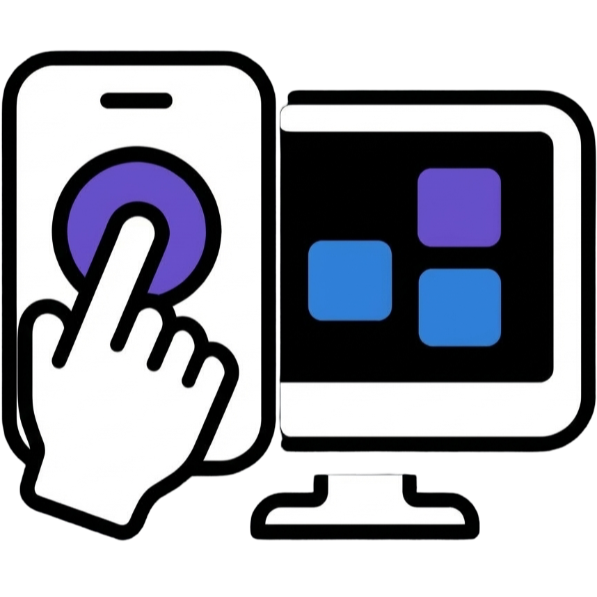
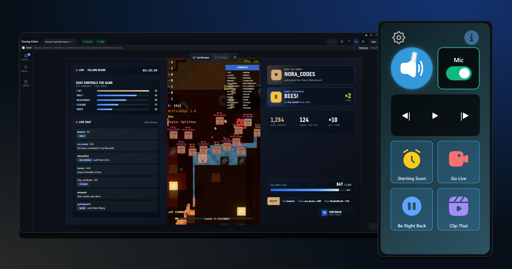
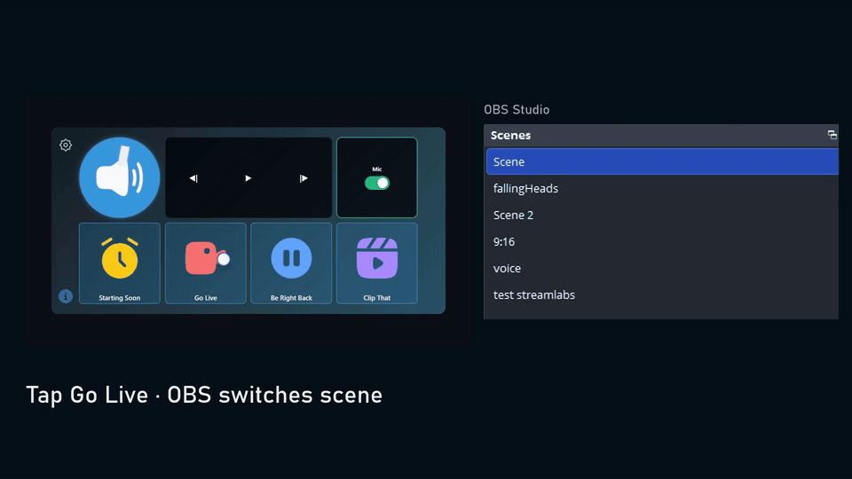
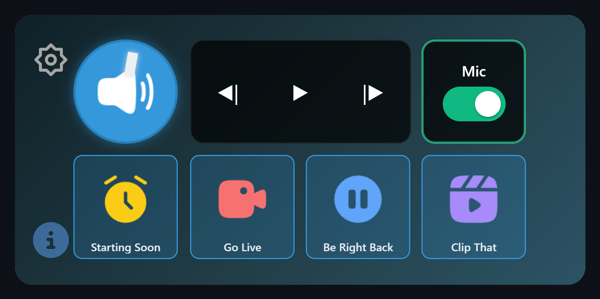
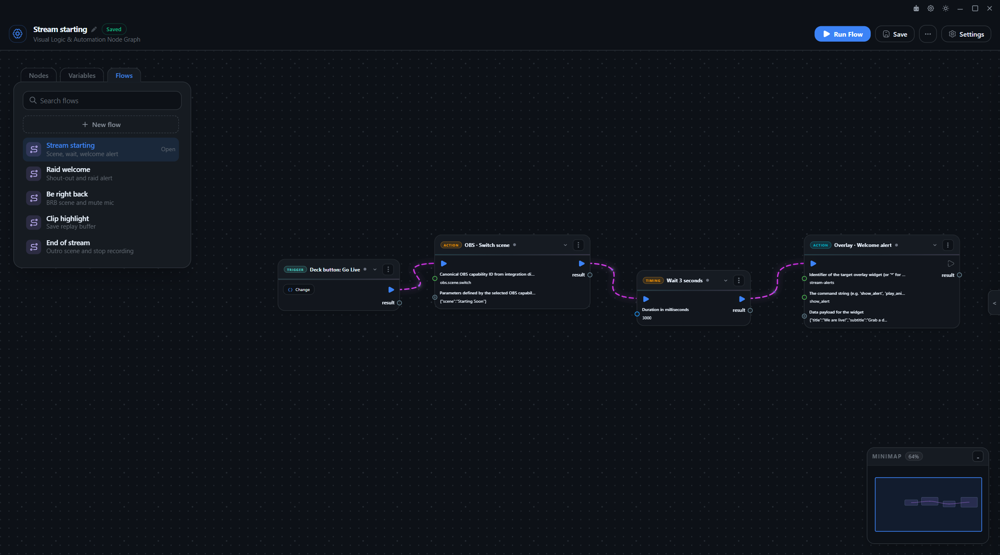
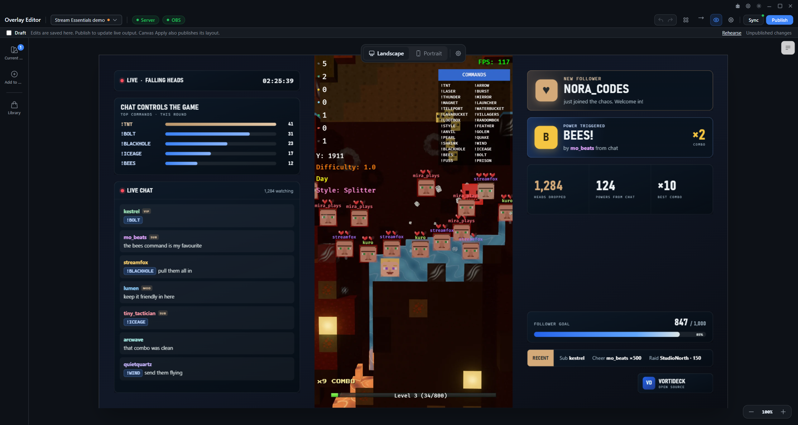
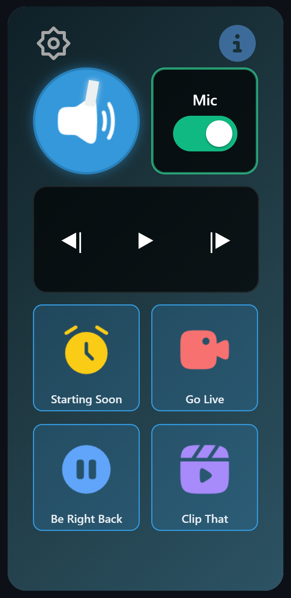

<p align="center">
  
</p>

<h1 align="center">VortiDeck</h1>

<p align="center">
  <strong>A free, local-first control deck, visual automation engine and live-streaming studio for Windows, with a phone companion app.</strong>
</p>

<p align="center">
  <a href="LICENSE"></a>
  <a href="packages/plugin-sdk/README.md"></a>
  <a href="https://github.com/vortideck/VortiDeck/actions/workflows/release-quality.yml"></a>
  
  <a href="https://discord.gg/keuv7TYHht"></a>
</p>

<p align="center">
  <a href="https://vortideck.com/download"><strong>Download</strong></a> ·
  <a href="https://vortideck.com">Website</a> ·
  <a href="https://vortideck.com/blog">Blog</a> ·
  <a href="packages/plugin-sdk/README.md">Plugin SDK</a> ·
  <a href="CONTRIBUTING.md">Contributing</a> ·
  <a href="SECURITY.md">Security</a>
</p>

<p align="center">
  
</p>

Created and maintained by **Alexi Pawelec** ([@alexiokay](https://github.com/alexiokay)).

## Download

Get the Windows installer from **[vortideck.com/download](https://vortideck.com/download)**. The phone companion app for Android is linked from the same page; pair it with the desktop app over your local Wi-Fi.

To build it yourself, see [Building from source](#building-from-source).

## What it does

<p align="center">
  
</p>

- **Control deck.** A customizable grid of buttons, controls and multi-action macros on your desktop or on your phone over local Wi-Fi.
- **Visual flows.** A node editor that chains deck buttons, chat commands, OBS actions, HTTP requests, system actions and AI tools. Runs survive a crash and wait for your decision instead of silently repeating actions.
- **OBS overlays.** An overlay editor with drafts, Undo/Redo, publish, rehearsal with sample events, built-in widgets (chat, goals, counters, timer, activity feed) and an OBS companion plugin managed from the app.
- **Chat commands.** Twitch, YouTube, Kick, Discord and TikTok commands with role policies that can trigger actions and flows.
- **Plugins.** WebAssembly plugins written in TypeScript with [`@vortideck/plugin-sdk`](packages/plugin-sdk/README.md), with a per-package permission grant.
- **AI assistant.** Bring your own key (OpenRouter, OpenAI, Anthropic) or use local models such as Ollama.

Everything above runs on your machine and is free. An account is only needed for hosted services such as remote access through the VortiDeck relay, marketplace purchases and streaming-account linking.

## Screenshots

<table>
  <tr>
    <td width="50%"><br><sub><b>Control deck.</b> Buttons, knobs, toggles and macros.</sub></td>
    <td width="50%"><br><sub><b>Visual flows.</b> Chain triggers, OBS actions and more in a node editor.</sub></td>
  </tr>
  <tr>
    <td width="50%"><br><sub><b>Overlay Editor.</b> Chat, goals, timers and alerts, published to OBS. Shown with the Stream Essentials widget pack, which is in development.</sub></td>
    <td width="50%" align="center"><br><sub><b>Phone companion.</b> Your deck on your phone over local Wi-Fi, shown in the built-in simulator.</sub></td>
  </tr>
</table>

## Repository layout

```
apps/
  tauri-windows/        Windows desktop app (Tauri 2, Rust)
    libs/vortideck-core Shared Rust core: flows, runtime, plugins, integrations
  tauri-mobile/         Android and iOS companion app
layers/                 Nuxt layers shared by the apps (base, desktop, desktop-streaming, flow, mobile, configuration)
packages/plugin-sdk/    @vortideck/plugin-sdk for plugin developers
examples/               Example plugins
docs/                   Architecture and plugin documentation
```

## Building from source

Prerequisites:

- Node.js 24 (see `.node-version`) and pnpm 9
- Rust 1.90 or newer with the MSVC toolchain (Windows)
- For the mobile app: Android SDK, NDK and JDK 21

```bash
pnpm install
```

The desktop app embeds the OBS companion plugin, which is built in its own repository ([OBS-Custom-Websocket-Plugin](https://github.com/alexiokay/OBS-Custom-Websocket-Plugin)). Download the latest release into place once (PowerShell):

```powershell
./scripts/stage-obs-companion.ps1 -Destination apps/tauri-windows/src-tauri/resources/plugins/vorti-obs-plugin.dll -ProvenancePath $env:TEMP/obs-companion-provenance.json -EmbeddedManifestDestination apps/tauri-windows/src-tauri/resources/obs-companion/manifest.json
```

Then start the desktop app:

```bash
pnpm start:desktop
```

Mobile companion (Android):

```bash
pnpm --filter vortideck-mobile run tauri:dev
```

Useful checks before opening a pull request:

```bash
pnpm --filter vortideck-desktop test
```

```bash
pnpm check:desktop:rust
```

## Writing plugins

```typescript
import vortideck, { createPlugin, defineNode, FlowParams } from "@vortideck/plugin-sdk";

export const { execute, register, get_metadata } = createPlugin({
  nodes: {
    uppercase: defineNode({
      metadata: {
        id: "com.example.text:uppercase",
        name: "Uppercase",
        description: "Convert text to uppercase",
        category: "text",
        type_color: "#4A90E2"
      },
      execute(input) {
        vortideck.log("Uppercase node executed");
        return { success: true, output: new FlowParams(input).getInput().toUpperCase() };
      }
    })
  }
});
```

See the [Plugin SDK guide](packages/plugin-sdk/README.md) and the [minimal contract plugin](examples/plugin-sdk-contract/).

## License

- The VortiDeck applications and core (everything outside `packages/` and `examples/`) are licensed under the **GNU General Public License v3.0 or later**. See [LICENSE](LICENSE).
- The plugin SDK (`packages/plugin-sdk`) and the example plugins (`examples/`) are licensed under the **MIT License**, so plugins you write can use any license, including commercial ones.
- Third-party components keep their own licenses. See [NOTICE](NOTICE).

"VortiDeck" and the VortiDeck logo are trademarks of Alexi Pawelec. The license covers the code, not the name or logo; forks must use their own name and branding.

## Support the project

VortiDeck is built by one person. If it is useful to you, you can support development through [GitHub Sponsors](https://github.com/sponsors/alexiokay) or by using the hosted services at [vortideck.com](https://vortideck.com).
