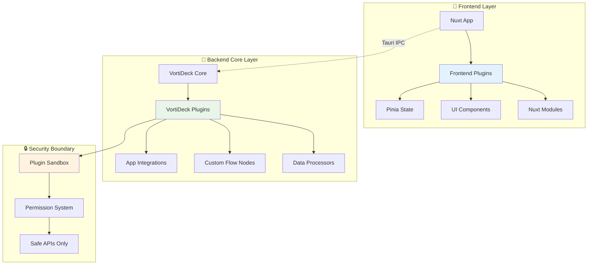

# Plugin Architecture Clarification

## **Two Distinct Plugin Systems**

VortiDeck has **two separate plugin systems** serving different purposes:

### **1. Frontend Plugins (`apps/tauri-windows/plugins/`)**
```
apps/tauri-windows/plugins/
├── pinia.ts          # Vue state management 
├── nuxt-*            # Nuxt framework plugins
└── ui-*              # Frontend/UI-related plugins
```

**Purpose**: Frontend/UI framework plugins (Nuxt, Vue, etc.)
- **Scope**: Frontend only (Nuxt/Vue ecosystem)
- **Language**: TypeScript/JavaScript  
- **Access**: UI state, frontend APIs
- **Examples**: Pinia, Nuxt modules, UI components

### **2. VortiDeck Plugin System (`libs/vortideck-core/src/modules/plugins/`)**
```
libs/vortideck-core/src/modules/plugins/
├── mod.rs            # Plugin system core
├── registry.rs       # Plugin registry & management
├── wasm.rs           # WASM plugin provider  
├── security.rs       # Plugin security validation
├── state.rs          # Plugin state management
└── loader.rs         # Plugin loading/unloading
```

**Purpose**: VortiDeck application plugins (extend core functionality)
- **Scope**: Backend core functionality
- **Language**: Rust (WASM support)
- **Access**: Controlled core APIs (with permission system)
- **Examples**: Custom integrations, new flow nodes, app connectors

## **Architecture Diagram**



## **Key Differences**

| Aspect | Frontend Plugins | VortiDeck Plugins |
|--------|------------------|-------------------|
| **Purpose** | UI/UX enhancement | Core functionality extension |
| **Language** | TypeScript/JS | Rust/WASM |
| **Security** | Standard web security | Sandboxed with permissions |
| **Access** | Frontend APIs only | Controlled core APIs |
| **Distribution** | npm packages | VortiDeck marketplace |
| **Installation** | npm/yarn | VortiDeck plugin manager |

## **Integration Examples**

### **Frontend Plugin (Pinia State)**
```typescript
// apps/tauri-windows/plugins/pinia.ts
export default defineNuxtPlugin(() => {
  // Frontend state management
  return {
    provide: {
      store: createPinia()
    }
  }
})
```

### **VortiDeck Plugin (Custom Integration)**
```rust
// Community plugin: Spotify integration
use vortideck_plugin_api::*;

#[plugin_main]
pub struct SpotifyPlugin;

impl Plugin for SpotifyPlugin {
    fn provides_integrations(&self) -> Vec<Box<dyn AppIntegration>> {
        vec![Box::new(SpotifyIntegration::new())]
    }
}
```

## **Why This Separation?**

### **✅ Clear Boundaries**
- **Frontend plugins**: Focus on UI/UX without security concerns
- **VortiDeck plugins**: Focus on core functionality with strict security

### **✅ Technology Alignment**  
- **Frontend**: Uses web technologies (TS/JS) and web security model
- **Backend**: Uses Rust with custom security sandbox

### **✅ Development Workflow**
- **Frontend devs**: Work with familiar npm/Nuxt plugin ecosystem
- **Backend devs**: Work with Rust and VortiDeck APIs

### **✅ Security**
- **Frontend**: Standard web app security (CSP, CORS)
- **Backend**: Custom permission system protecting core APIs

## **Migration Notes**

When migrating to the new architecture:

1. **Keep frontend plugins** in `apps/tauri-windows/plugins/` - they're correct
2. **VortiDeck plugin system** stays in `libs/vortideck-core/src/modules/plugins/`  
3. **No confusion**: Two systems, two purposes, no overlap
4. **Clear documentation**: This prevents future confusion

## **Best Practices**

### **For Frontend Plugins**
- Use for UI state management, component libraries, Nuxt modules
- Follow standard Nuxt plugin conventions
- No direct core business logic access

### **For VortiDeck Plugins**  
- Use for extending VortiDeck's core capabilities
- Follow VortiDeck plugin API and security guidelines
- Declare permissions and feature requirements properly

This separation keeps the architecture clean and each plugin system focused on its specific purpose! 🎯 