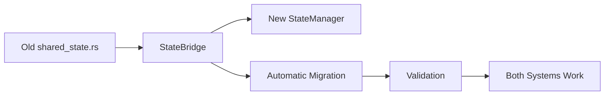

# VortiDeck State Management Migration Guide

## Overview

This guide explains the migration from the old `shared_state.rs` (642 lines) to the new **StateManager** architecture in `vortideck-core`. The new system provides:

- **🔒 Security**: Public/Private state separation for plugin safety
- **🚀 Headless**: Works without UI (server, CLI, testing)
- **🔧 Maintainable**: Clean separation of concerns
- **📦 Plugin-Ready**: Controlled access for community plugins

## Architecture Comparison

### Old System (shared_state.rs)
```rust
// ❌ Everything mixed together - 642 lines
pub struct AppState {
    secret: RwLock<Option<String>>,           // Auth (should be private)
    server_data: RwLock<Option<ServerInfo>>,  // Server (should be private)
    is_pinned_mobile_simulator: RwLock<bool>, // UI (can be public)
    server_sender: RwLock<Option<broadcast::Sender<Message>>>, // Internal
    enigo: Arc<Mutex<Enigo>>,                 // System access
}

pub struct ObsPluginState {
    // OBS-specific state mixed with general state
    obs_plugin_sender: Arc<AsyncRwLock<broadcast::Sender<Message>>>,
    instance_guid: Arc<RwLock<Option<String>>>,
    actions: Arc<AsyncRwLock<Option<Vec<ObsPluginAction>>>>,
    status: Arc<AsyncRwLock<bool>>,
}

pub struct PeerState {
    // Peer management separate from everything else
    peer_map: TokioMutex<HashMap<String, PeerInfo>>,
}
```

### New System (StateManager)
```rust
// ✅ Clean separation with security boundaries
pub struct StateManager {
    public_state: PublicState,   // ✅ Plugins can access
    private_state: PrivateState, // ❌ Plugins cannot access
}

pub struct PublicState {
    ui_state: Arc<RwLock<UIState>>,         // UI preferences, window state
    module_state: Arc<RwLock<ModuleState>>, // OBS status, recording state
    peer_state: Arc<PeerState>,             // Peer connections
}

pub struct PrivateState {
    auth_state: Arc<RwLock<AuthState>>,       // Auth tokens, premium status
    server_state: Arc<RwLock<ServerState>>,   // Server config, senders
    security_state: Arc<RwLock<SecurityState>>, // Secrets, plugin permissions
}
```

## Migration Status

### ✅ **Current Status: Bridge Architecture Active**

We're using a **StateBridge** that allows both systems to coexist:

1. **Old system** still works (backward compatibility)
2. **New system** is available and ready
3. **Bridge** automatically migrates data between them
4. **Feature flag** controls which system to use

### 🔄 **Migration Strategy**



## Using the New State System

### 1. **Basic State Access**

```rust
use crate::state_bridge::get_state_bridge;

// Get the bridge (always available)
let bridge = get_state_bridge();

// Access UI state (plugin-safe)
bridge.pin_mobile_simulator();
let is_pinned = bridge.is_mobile_simulator_pinned();

// Access module state (plugin-safe)
bridge.set_obs_status(true);
let obs_status = bridge.get_obs_status();

// Access private state (core systems only)
bridge.set_premium_status(true);
let is_premium = bridge.is_premium();
```

### 2. **Plugin-Safe Access**

```rust
// Plugins can only access public state
let bridge = get_state_bridge();
let public_state = bridge.get_public_state();

// ✅ Allowed: UI and module state
let ui_state = public_state.ui_state;
let module_state = public_state.module_state;
let peer_state = public_state.peer_state;

// ❌ Blocked: Private state (auth, server, security)
// Plugins cannot access these directly
```

### 3. **Plugin Permission System**

```rust
// Set plugin permissions
let state_manager = bridge.state_manager();
state_manager.set_plugin_permissions(
    "my_plugin".to_string(),
    PluginPermissions {
        can_access_ui_state: true,
        can_access_module_state: false,
        can_execute_system_commands: false,
        allowed_integrations: vec!["obs".to_string()],
        feature_requirements: vec!["premium_feature".to_string()],
    }
);

// Check permissions before access
if state_manager.check_plugin_permission("my_plugin", "ui_state") {
    // Plugin can access UI state
} else {
    // Access denied
}
```

## New Tauri Commands

### State Management Commands

```typescript
// Frontend can use these new commands
import { invoke } from '@tauri-apps/api/tauri';

// Mobile simulator
await invoke('pin_mobile_simulator');
await invoke('unpin_mobile_simulator');
const isPinned = await invoke('get_mobile_simulator_pin_status');

// OBS status
await invoke('set_obs_status_new', { status: true });
const obsStatus = await invoke('get_obs_status_new');

// Server info
const serverInfo = await invoke('get_server_info_new');

// Peers
const peers = await invoke('get_peers_new');
await invoke('broadcast_message_new', { message: { type: 'test' } });

// Premium status
const isPremium = await invoke('get_premium_status_new');
await invoke('set_premium_status_new', { isPremium: true });

// Plugin permissions
await invoke('set_plugin_permissions', {
    pluginId: 'my_plugin',
    canAccessUiState: true,
    canAccessModuleState: false,
    canExecuteSystemCommands: false,
    allowedIntegrations: ['obs'],
    featureRequirements: ['premium']
});

const hasPermission = await invoke('check_plugin_permission', {
    pluginId: 'my_plugin',
    permission: 'ui_state'
});

// Get safe state for plugins
const safeState = await invoke('get_public_state_for_plugin', {
    pluginId: 'my_plugin'
});
```

### Migration Validation Commands

```typescript
// Compare old vs new systems
const comparison = await invoke('compare_state_systems');
console.log('State migration status:', comparison);

// Get system status
const status = await invoke('get_state_system_status');
console.log('Using new state:', status.using_new_state);
```

## Environment Variables

Control the migration with environment variables:

```bash
# Use new state system (for testing)
export VORTIDECK_USE_NEW_STATE=true

# Use old state system (default)
export VORTIDECK_USE_NEW_STATE=false
# or don't set the variable
```

## Plugin Development

### For Plugin Developers

```rust
// In your plugin code
use vortideck_core::core::{PublicState, StateManager};

pub struct MyPlugin {
    // Store reference to public state only
    public_state: PublicState,
}

impl MyPlugin {
    pub fn new(public_state: PublicState) -> Self {
        Self { public_state }
    }
    
    pub async fn do_something(&self) -> Result<(), String> {
        // ✅ Can access UI state
        let ui_state = self.public_state.ui_state.read().unwrap();
        let is_pinned = ui_state.is_mobile_simulator_pinned;
        
        // ✅ Can access module state
        let module_state = self.public_state.module_state.read().unwrap();
        let obs_status = module_state.obs_status;
        
        // ✅ Can access peers
        let peers = self.public_state.peer_state.get_peers().await;
        
        // ❌ Cannot access private state (auth, server, security)
        // This is enforced at compile time
        
        Ok(())
    }
}
```

### Plugin Permission Levels

```rust
// Different permission levels for different plugin types
pub enum PluginTier {
    Community {
        // Restrictive permissions
        can_access_ui_state: true,
        can_access_module_state: false,
        can_execute_system_commands: false,
    },
    
    Official {
        // More permissions
        can_access_ui_state: true,
        can_access_module_state: true,
        can_execute_system_commands: false,
    },
    
    System {
        // Full permissions (for core integrations)
        can_access_ui_state: true,
        can_access_module_state: true,
        can_execute_system_commands: true,
    },
}
```

## Migration Benefits

### ✅ **Security**
- **Private state** protected from plugins
- **Permission system** controls plugin access
- **Auth tokens** and **secrets** never exposed to plugins

### ✅ **Headless Ready**
- **No UI dependencies** in core state
- **Works in server mode** without Tauri
- **CLI tools** can use same state system

### ✅ **Plugin Ecosystem**
- **Safe plugin access** to public state
- **Permission-based** feature access
- **Community plugins** can't break core systems

### ✅ **Maintainable**
- **Clear boundaries** between public/private
- **Organized state** by concern (UI, modules, auth, etc.)
- **Easy testing** with mock state

## Migration Timeline

### **Phase 1: ✅ COMPLETE - Bridge Architecture**
- [x] New StateManager implemented
- [x] StateBridge created for compatibility
- [x] Automatic migration between systems
- [x] New Tauri commands available
- [x] Plugin permission system working

### **Phase 2: 🔄 IN PROGRESS - Gradual Adoption**
- [ ] Update existing commands to use bridge
- [ ] Test new system with environment variable
- [ ] Validate migration in production
- [ ] Update frontend to use new commands

### **Phase 3: 📅 PLANNED - Full Migration**
- [ ] Switch default to new system
- [ ] Remove old shared_state.rs
- [ ] Update all plugins to use new system
- [ ] Complete documentation

## Testing the Migration

### 1. **Enable New System**
```bash
# Set environment variable
export VORTIDECK_USE_NEW_STATE=true

# Run VortiDeck
cargo run
```

### 2. **Validate Migration**
```typescript
// In frontend console
const comparison = await invoke('compare_state_systems');
console.log('Migration validation:', comparison);

// Should show all fields matching between old and new systems
```

### 3. **Test Plugin Permissions**
```typescript
// Test plugin access
const safeState = await invoke('get_public_state_for_plugin', {
    pluginId: 'test_plugin'
});
console.log('Plugin can access:', safeState);

// Test permission denial
try {
    await invoke('get_public_state_for_plugin', {
        pluginId: 'unauthorized_plugin'
    });
} catch (error) {
    console.log('Access denied (expected):', error);
}
```

## Troubleshooting

### **Migration Not Working**
```bash
# Check if bridge is initialized
grep "State bridge initialized" logs/

# Check environment variable
echo $VORTIDECK_USE_NEW_STATE

# Validate migration
cargo run -- --validate-migration
```

### **Plugin Access Denied**
```rust
// Check plugin permissions
let state_manager = bridge.state_manager();
let has_permission = state_manager.check_plugin_permission("plugin_id", "ui_state");
println!("Plugin permission: {}", has_permission);

// Set permissions if needed
state_manager.set_plugin_permissions("plugin_id", PluginPermissions {
    can_access_ui_state: true,
    // ... other permissions
});
```

### **State Not Syncing**
```rust
// Force migration
let bridge = get_state_bridge();
bridge.migrate_from_old_state(&app_handle);

// Validate migration
let is_valid = bridge.validate_migration(&app_handle);
println!("Migration valid: {}", is_valid);
```

## Next Steps

1. **Test the new system** with `VORTIDECK_USE_NEW_STATE=true`
2. **Update your plugins** to use the new public state API
3. **Validate migration** with the comparison commands
4. **Report any issues** with the migration process

The new StateManager is **production-ready** and provides a **solid foundation** for VortiDeck's plugin ecosystem and headless architecture! 