# VortiDeck Agent System — Architecture Vision

> **Architecture clarification, 5 September 2026:** This is a vision, not the current runtime map. The [consolidated guide](ARCHITECTURE_GUIDE.md) preserves the existing flow and conversation runtimes. Flow-versus-agent lifetime comparisons below are illustrative and misleading as architecture rules: durable flows can wait for hours or days. A second agent runtime is not required by that distinction.

> **Planning update, 5 September 2026:** Architecture vision, not a description of a complete agent runtime. A03/A04/P02 reconsider fixed polling, lifespan-based flow/agent distinctions and additional runtimes. Begin with one owned task lifecycle, bounded authorized effects and actual evidence. Use root TODO and the detailed backlog for current task status and acceptance evidence.

---

## 1. App Structure Overview

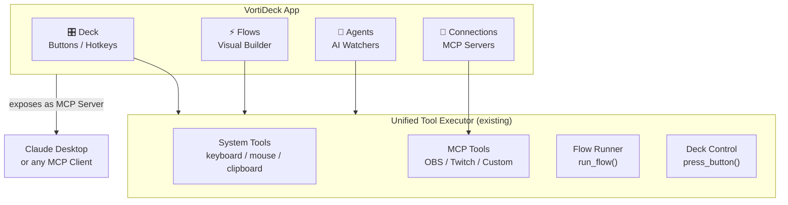

---

## 2. Agent vs Flow — What's the Difference

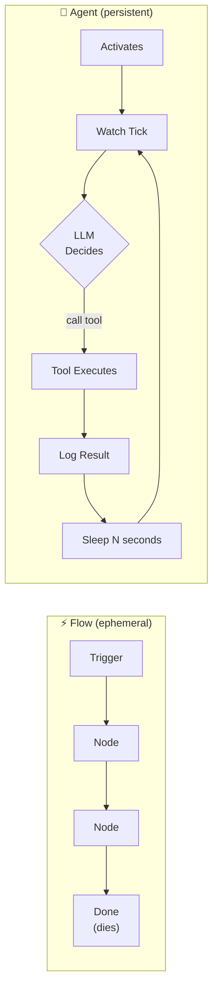

| | Flow | Agent |
|---|---|---|
| Lifetime | Milliseconds, then dies | Runs for hours, persists |
| Trigger | User action / webhook | Autonomous: timer, event |
| Intelligence | Deterministic steps | LLM is the brain |
| State | Stateless between runs | Memory builds over time |
| You define | Every step | Just the goal |

---

## 3. Agent Anatomy

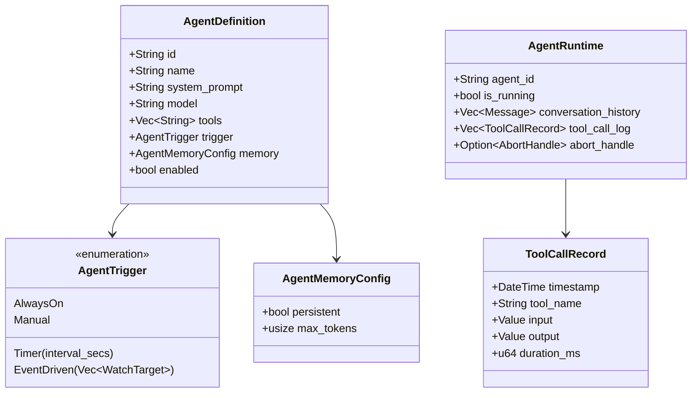

---

## 4. Agent Runtime Loop

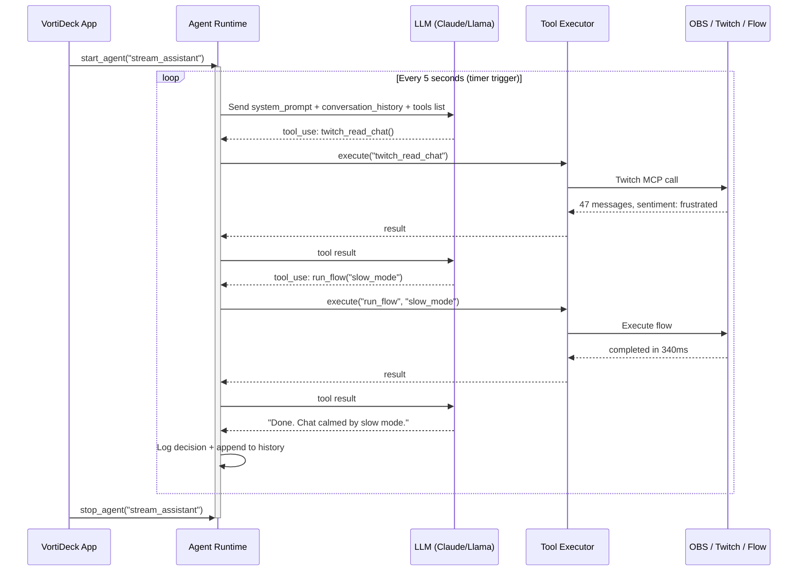

---

## 5. How Agents and Flows Work Together

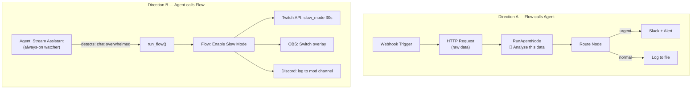

---

## 6. MCP Layer — Two Directions

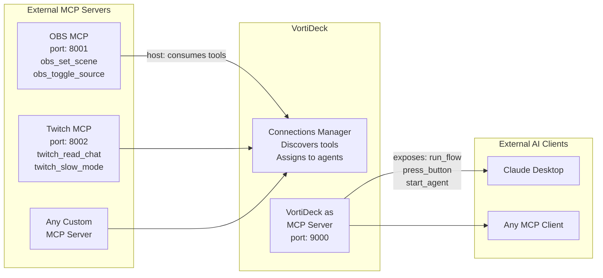

---

## 7. Rust Module Structure

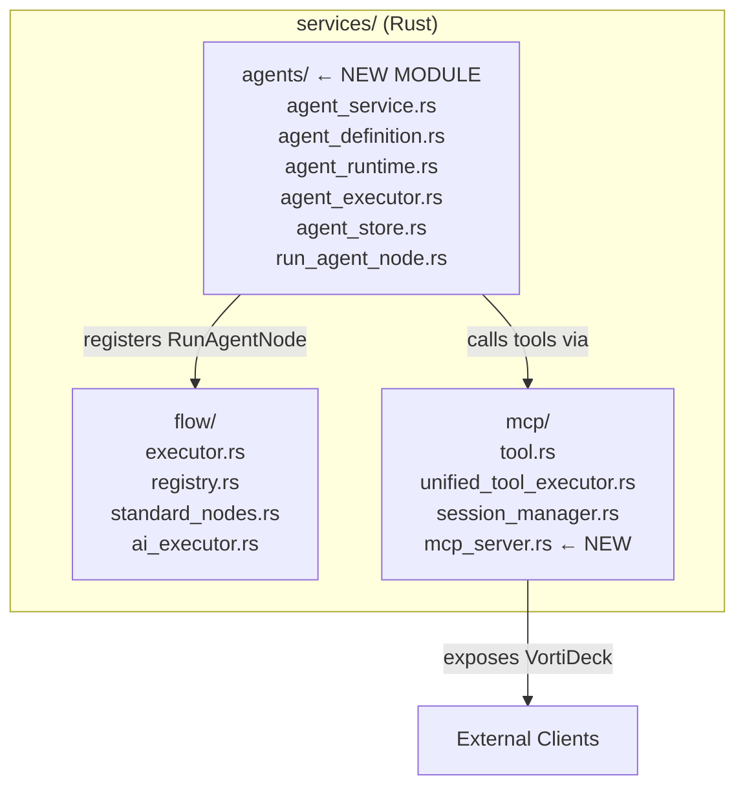

---

## 8. UI Structure

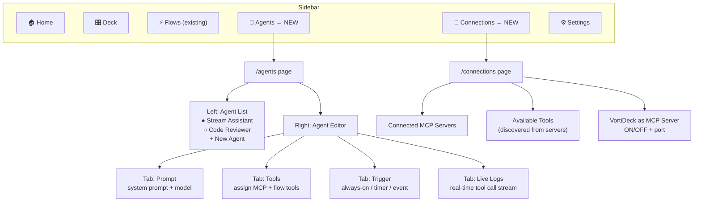

---

## 9. RunAgentNode in the Flow Builder

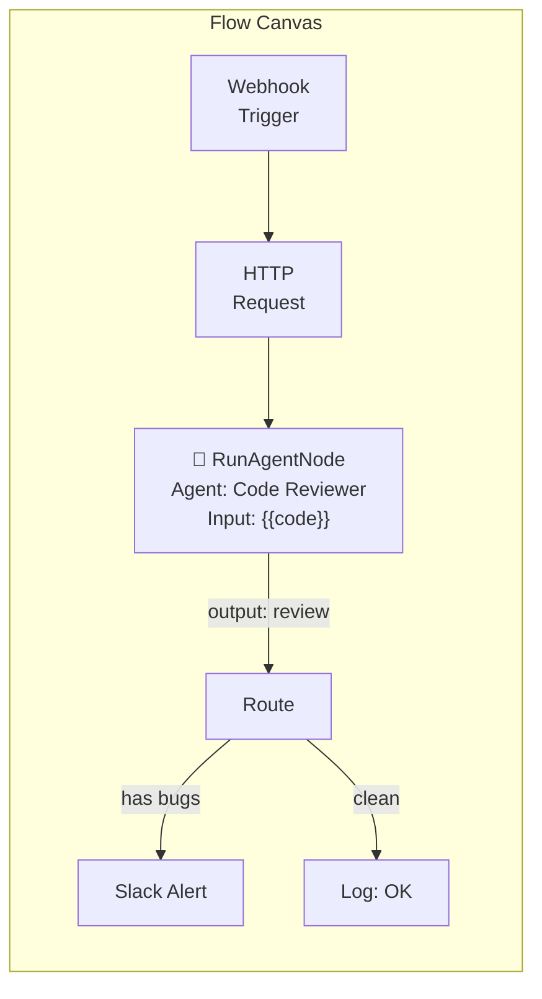

**RunAgentNode behavior:**
- One-shot call (no persistent loop, no memory)
- Spawns agent with its configured tools
- Waits for final response
- Returns text or structured JSON to next node
- Same agent definition reused — just different execution mode

---

## 10. Build Phases

```mermaid
gantt
    title Agent System Build Phases
    dateFormat  X
    axisFormat  Phase %s

    section Phase 1 - Core MVP
    Rust agents/ module          :p1a, 0, 1
    Tauri commands               :p1b, 0, 1
    /agents page + editor        :p1c, 0, 1
    Live log tab                 :p1d, 0, 1
    Sidebar item                 :p1e, 0, 1

    section Phase 2 - MCP UI
    /connections page            :p2a, 1, 2
    Tool discovery display       :p2b, 1, 2
    Assign tools to agents       :p2c, 1, 2

    section Phase 3 - Flow Integration
    RunAgentNode                 :p3a, 2, 3
    Expose flow as Agent Tool    :p3b, 2, 3

    section Phase 4 - VD as MCP Server
    mcp_server.rs                :p4a, 3, 4
    Expose flows/agents/deck     :p4b, 3, 4
    Settings UI                  :p4c, 3, 4
```

---

## 11. Stream Assistant — Full End-to-End Example

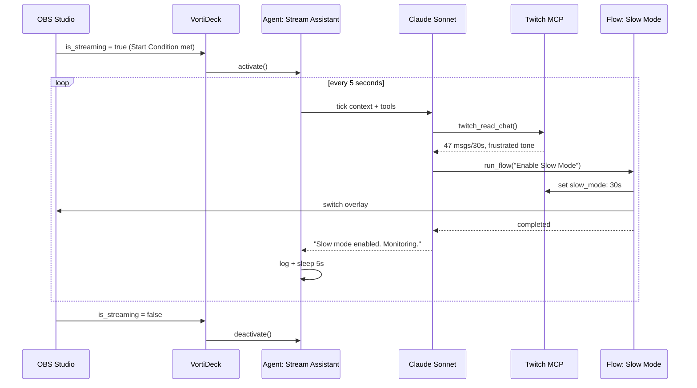

---

## Summary Table

| Concept | What it is |
|---|---|
| **Agent** | Named AI process with a goal, runs in background autonomously |
| **Watcher** | Agent with timer/event trigger that polls and acts |
| **AgentTool** | Any flow tagged as callable by agents via `run_flow()` |
| **RunAgentNode** | Flow node that calls an agent inline for smart reasoning |
| **MCP Host** | VortiDeck consuming tools from OBS/Twitch/custom servers |
| **MCP Server** | VortiDeck exposing itself so Claude Desktop can control it |
| **Connections** | Page for managing all external MCP server connections |
