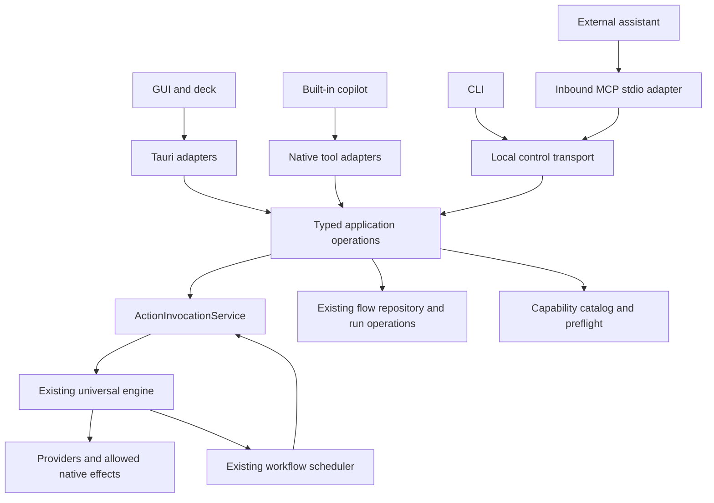

# CLI, MCP and shared application services

Status: proposed implementation design, updated 6 September 2026 at HEAD `5f26f18a` plus substantial uncommitted work. The CLI and inbound MCP server remain proposals. H01 has added FlowRuntime and a bounded LocalFlowHost proof; H02 explicitly defers packaging it as a daemon. Complete the stabilization follow-ups before treating that proof as a supported control interface.

Related work: root completion ledger, detailed backlog, especially A01/A02/A04/A06, R02/R04/R05, S04 and H01/H02. The implementation slices below are local to this proposal and do not change the completion status of those tasks.

Architectural clarification: the [current architecture guide](ARCHITECTURE_GUIDE.md) supersedes any reading of this proposal as requiring a new service hierarchy. Reuse suitable existing operations directly. Extract a shared function/module only when it removes duplicated behavior or owns a real invariant. H01 deleted the unused `FlowService`; do not recreate it.

## 1. Decision and product purpose

Build on the current architecture. Do not rewrite the execution engine, replace the flow graph, introduce another plugin system or reorganize the whole repository to add a CLI.

The useful addition is a small, explicit external contract exposing suitable existing runtime operations, with different adapters:

- The built-in copilot calls application operations in process.
- An inbound MCP adapter exposes selected operations to external assistants.
- A CLI exposes selected operations to PowerShell, scripts, launchers and developers.
- Existing Tauri commands reuse the same operations where behavior overlaps.

MCP is the preferred interface for an external assistant that supports it. The CLI earns its place through scripting and operational diagnostics; it is not necessary merely to make VortiDeck agent-accessible. Both can be delivered independently after a small shared boundary exists.

First product scenario: inspect the running studio, discover a saved action, invoke it, and inspect an honest outcome. A second scenario is reading and safely replacing an inactive flow at a known revision. Cloud hosting, arbitrary remote shell access, plugin installation, deck authoring and a second automation DSL are outside the first release.

**Verdict:** the current modularity is useful and sufficient for incremental extension. It does not yet mean every operation has one shared application entry point, or that a separate runtime host is ready. Finish those specific seams as needed, rather than treating every unfinished TODO as a reason for a rewrite.

## 2. What exists after the recent changes

These findings come from source inspection and the current completion ledger. Reported execution-note tests were read, not rerun for this documentation task. A checked box and a promising class name are not independent end-to-end validation.

| Existing location | Observed behavior | Design consequence |
|---|---|---|
| [execution/invocation.rs](../../apps/tauri-windows/libs/vortideck-core/src/services/execution/invocation.rs) | `ActionInvocationService` resolves references, persists invocation intent, runs work in an owned task, persists outcomes, and exposes get/list queries. | Reuse it for effects and receipts. Add missing lifecycle methods here, not in a CLI executor. |
| [execution/action_converter.rs](../../apps/tauri-windows/libs/vortideck-core/src/services/execution/action_converter.rs) | `ActionReference` distinguishes saved actions, flows, macros and other existing references; some legacy reference kinds still use numeric IDs. | Preserve reference identity. Do not promise that every object already has a portable stable ID. |
| [integrations/contracts.rs](../../apps/tauri-windows/libs/vortideck-core/src/integrations/contracts.rs) and [universal_manager.rs](../../apps/tauri-windows/libs/vortideck-core/src/integrations/universal_manager.rs) | Versioned capabilities, parameter validation, preflight, receipt and recovery semantics, dynamic options and provider status exist. | This is the reusable provider contract. CLI/MCP should discover it rather than invent another catalog. |
| [execution/mod.rs](../../apps/tauri-windows/libs/vortideck-core/src/services/execution/mod.rs) | Execution context, universal actions, engine dispatch and package permission checks exist. Integration dispatch explicitly expects remote transports to authorize callers before constructing context. | The context is not by itself a complete external-client authorization system. Add the external boundary deliberately. |
| [flow/executor.rs](../../apps/tauri-windows/libs/vortideck-core/src/services/flow/executor.rs) | Graph validation, semantic revisions, conditional replacement, restricted inactive-flow editing, workflow execution and recovery records exist. | Reuse these operations and their persistence rules. A CLI must not write graph JSON directly into SQLite. |
| [flow/runtime.rs](../../apps/tauri-windows/libs/vortideck-core/src/services/flow/runtime.rs) | H01 removed the old FlowService and added FlowRuntime, owning recovery, ingress installation and router lifecycle over the existing handles. | Reuse this owner; complete F03's shutdown/admission checks. Do not add another executor. |
| [mcp/tools.rs](../../apps/tauri-windows/libs/vortideck-core/src/services/mcp/tools.rs) | Native tools read actual flow storage, expose revision-checked inactive replacement and invoke actions through the invocation service. Missing repositories produce unavailable diagnostics. | Older fabricated-flow findings are not a reason to recreate these tools. Extract shared behavior from their current implementations. |
| [mcp/tool.rs](../../apps/tauri-windows/libs/vortideck-core/src/services/mcp/tool.rs) and [unified_tool_executor.rs](../../apps/tauri-windows/libs/vortideck-core/src/services/mcp/unified_tool_executor.rs) | Tool schemas, context propagation, native/outbound tools and a pure-computation restriction for directly executed AI flow nodes exist. The tool interface still returns serialized strings. | Keep this as assistant/tool adaptation. Do not make string-valued `Tool::call` the application API. |
| [main.rs](../../apps/tauri-windows/src-tauri/src/main.rs) | The desktop composes the actual flow executor, chat state, providers, invocation service and readiness, and now installs FlowRuntime over its existing handles. | Attach local control to those instances. H01's bounded extraction is done; provider-wide daemon composition is not automatically complete. |
| [universal_action_commands.rs](../../apps/tauri-windows/src-tauri/src/commands/universal_action_commands.rs) and [flow_commands.rs](../../apps/tauri-windows/src-tauri/src/adapters/flow_commands.rs) | Tauri adapters contain both thin forwarding and reusable catalog/preflight/binding logic. | Extract only the operations needed by the new interface, preserving existing command signatures. |
| [flow/local_host.rs](../../apps/tauri-windows/libs/vortideck-core/src/services/flow/local_host.rs) and [core Cargo manifest](../../apps/tauri-windows/libs/vortideck-core/Cargo.toml) | A loopback authenticated proof exists; the old core/runtime.rs stub was removed. Core dependencies still include native integrations and a large runtime. | A thin CLI should not depend on the full core just to send a request. Harden/version the selected protocol and satisfy H02 before shipping a daemon; the proof is not the final CLI protocol. |
| [local_server.rs](../../apps/tauri-windows/src-tauri/src/local_server.rs) | The existing HTTP server composes device, overlay, metrics and webhook routes and can bind multiple network addresses. | Do not expose privileged control by simply adding routes to every existing listener or reusing an overlay token. |

The root file named `cli` is an Extism CLI download script, not a VortiDeck command-line program. Do not overwrite it as though it were an empty placeholder.

Historical clarification: `FlowService` was introduced in commit `890b446b` on 10 July 2025. At that revision and at `desktop-v0.6.9`, the searched Rust sources contained its definition and alternate `main_soa_*` references, but no production constructor. The v0.6.9 desktop already used `commands::FlowExecutorState` and FlowExecutor directly. H01 has now removed that unused wrapper and its duplicate state definitions. The working engine was retained; new FlowRuntime supplies actual lifecycle ownership.

The current MCP distinction is also important: the outbound `rmcp` client is real; internal native tools are real; an inbound VortiDeck MCP transport was not found in the inspected paths. The previous `services/mcp/server.rs` facade is deleted in this working tree. A06's note now documents removal and real outbound transport evidence. Do not resurrect the facade from its historical baseline or claim inbound interoperability from unit tests of a `ToolSet`.

R02 is marked complete and its execution note describes queue callers awaiting their own result and owned work surviving caller-future cancellation. Preserve this improvement. It does not establish a public asynchronous submission API or restart-durable in-memory queues.

## 3. Are the shared things flow nodes?

No. There are several useful layers, with different responsibilities:

| Concept | Example | Responsibility |
|---|---|---|
| Provider capability | A registered OBS scene-selection capability | Describes inputs, availability, permissions and effect receipts; implemented by a provider. |
| Saved action/reference | A saved “Recording scene” binding | Identifies configured behavior that multiple surfaces can invoke. |
| Universal action | Resolved integration action, macro or flow | Internal executable representation understood by the engine. |
| Flow node | Invoke-action, branch, delay, variable transform | Participates in graph scheduling, data/control edges and run context. |
| Application operation | Inspect action, invoke reference, read flow, replace inactive flow, inspect invocation | Implements a user-facing use case consistently across adapters. |
| Adapter | Tauri command, CLI command, MCP tool | Converts input/output and authenticates its transport without owning a second implementation of the use case. |

For example, the deck button, a flow's invoke-action node, and a CLI invocation can all resolve the same saved action and reach `ActionInvocationService`. The CLI does not need to construct a one-node flow. Conversely, a delay or branch node is meaningful in the scheduler and should not automatically become a public CLI/MCP operation.

Preserve `AiToolExecutionPolicy::PureComputation` for approved direct node tools. Do not recreate the removed FlowService node-execution bypass or expose arbitrary registry dispatch/all UniversalAction variants as an external shortcut.



The scheduler-to-invocation edge represents effects performed by graph nodes. The flow invocation starts a workflow; it must not recursively start the same graph as a replacement for node execution. Invocation identity, run identity and node identity remain separate.

## 4. Code placement and dependency rules

Use the current repository layout. Do not move the whole Rust core out of `apps/tauri-windows` as a prerequisite. Proposed paths below do not exist yet unless explicitly marked existing. They show possible placement, not directories to scaffold in advance. In particular, omit `services/control` if existing domain modules already supply the needed operations.

```text
apps/cli/                                      NEW, standalone Cargo package
  Cargo.toml                                  binary: vortideck-cli
  src/main.rs                                 args, output mode, exit mapping
  src/lib.rs                                  client methods shared with MCP mode
  src/client.rs                               local transport, handshake, deadlines
  src/commands/                               status, catalog, invocation, flow adapters
  src/mcp.rs                                  optional inbound MCP stdio adapter

packages/vortideck-control-protocol/             NEW, small Rust package
  Cargo.toml
  src/lib.rs                                  versioned wire requests/results/errors

apps/tauri-windows/libs/vortideck-core/src/
  services/control/                           OPTIONAL, only for cross-domain policy
    mod.rs                                    minimal composition if actually needed
    context.rs                                verified caller and operation policy
    catalog.rs                                extracted saved-action queries/preflight
    diagnostics.rs                            typed read-only diagnostics
  services/execution/invocation.rs             EXISTING, identity/lifecycle/receipts
  services/flow/runtime.rs                      EXISTING lifecycle owner from H01
  services/flow/local_host.rs                   EXISTING bounded proof; not a shipped daemon
  services/flow/                               EXISTING, reuse meaningful operations here
  services/mcp/tools.rs                        EXISTING, thin native tool adapters

apps/tauri-windows/src-tauri/src/
  control/mod.rs                              NEW, listener ownership/start/stop
  control/transport.rs                        NEW, local IPC and peer authentication
  control/dispatch.rs                         NEW, typed request-to-operation mapping
  commands/universal_action_commands.rs        EXISTING, progressively thinner
  adapters/flow_commands.rs                    EXISTING, progressively thinner
  main.rs                                     EXISTING, inject current runtime handles
```

If `services/control` is needed, keep it small. It must own actual cross-domain policy rather than duplicate the APIs of the engine or flow runtime. Use existing methods or focused functions initially; introduce a trait only where there is a real alternative implementation or a useful test seam. Catalog-only extraction may belong directly in the integrations module.

The protocol package contains serializable DTOs and schemas, not Diesel records, `AppHandle`, chat state, provider implementations, a database connection or runtime bootstrap. CLI depends on this package and its transport libraries, not on `vortideck-core`. The host/core map between DTOs and existing domain types explicitly. This bounded mapping is useful separation, not a second graph format.

Keep existing flow JSON canonical. Initially export it as a JSON document in the response and validate it using the current core deserializer. Do not duplicate all `FlowDefinition` types into a second hand-maintained protocol model. If offline validation becomes a demonstrated need, extract a small shared flow-document package in a separate slice.

Keep the client library inside `apps/cli` initially; extract a separate client package only when another executable actually needs it. Avoid introducing a root Cargo workspace or repinning dependencies for unrelated applications in the first slice.

**Executable naming:** ship `vortideck-cli.exe` on Windows initially. The desktop binary is named `VortiDeck`; placing a new `vortideck.exe` beside `VortiDeck.exe` creates a filename collision on ordinary Windows installations. Use `vortideck-cli` consistently in scripts on supported systems. A shorter alias can be an optional packaging decision after checking collisions.

## 5. Shared operations and migration

The following operation names describe the proposed contract; they are not existing Rust method names unless linked above.

| Operation | Current implementation to reuse | Necessary adaptation |
|---|---|---|
| Runtime status | `ActionRuntimeReadiness`, provider status, host instance metadata | Return initialization phase, missing facilities and observation time without waiting indefinitely for ready. |
| List/inspect saved actions | Saved-action queries in Tauri commands | Move read logic to `services/control/catalog.rs`; explicit pagination and reference types. |
| Discover/preflight capabilities | `UniversalIntegrationManager` and capability contracts | Filter for the caller, preserve contract version, distinguish unavailable from unsupported. |
| Invoke reference | `ActionInvocationService::invoke_reference` | Trusted caller context; stable external request correlation; no caller-supplied privileged `ExecutionContext`. |
| Inspect/list invocation | Existing invocation queries | Redacted public DTO; preserve nonterminal dispatch phase separately from terminal result. |
| Read/list/edit inactive flow | `FlowExecutor` repository and revision methods | Reuse these directly or extract a focused operation in the flow module; preserve current restricted editing rules. |
| Inspect/cancel workflow run | Existing runtime storage, active state and cancellation | Address by run ID, combine live and persisted read paths; report cancellation limitations. |
| Studio/overlay diagnostics | Readiness, preflight and host-specific OBS/overlay observations | Inject a narrow host diagnostic reader; report actual evidence and unavailable checks. |

Use the same executor/registry handles already owned by FlowRuntime and composed by `main.rs`. Do not reconstruct the removed FlowService bootstrap. Move the `SharedFlowExecutor` alias from `mcp/tools.rs` to its domain owner if cross-adapter sharing actually requires it; this is a small ownership change, not a new service layer.

Do not hold the shared executor/registry mutex over a long action wait or provider network call. Clone the needed handle/snapshot while locked, then release it where the current ownership model permits. If a specific operation cannot do this, change that handle boundary and test cancellation responsiveness; do not redesign all scheduling first.

Migrate behavior operation by operation: extract it, route its existing Tauri/native-tool callers through it, then add the new adapter. Preserve public UI signatures during migration. Do not keep two independently evolving copies of flow edit checks or action preflight.

## 6. Runtime connection and process ownership

First host: the already-running desktop process. The CLI does not initialize SQLite, providers, plugin watchers, the scheduler or a second application instance. If no instance is running, return `runtime_unavailable` with a clear instruction to start VortiDeck. No silent auto-start in v1.

Recommended Windows transport: a local named pipe with an explicit descriptor limited to the intended user/logon session, remote clients rejected, and first-instance ownership enforced. Validate the peer and endpoint owner; a matching pipe name alone is not authentication. Microsoft documents that default named-pipe ACLs can grant broader read access, so use an explicit descriptor and test it. [Named-pipe security](https://learn.microsoft.com/en-us/windows/win32/ipc/named-pipe-security-and-access-rights)

For later macOS/Linux support, use a Unix-domain socket inside a private per-user runtime directory with peer/permission checks. Do not advertise those platforms until build and transport tests run there.

Use a small private request/reply protocol over the local stream: length-prefixed UTF-8 JSON, a bounded frame size (initially 1 MiB), validated message types, request IDs and connection deadlines. Start with bounded queries and submissions; `watch` can poll authoritative state, so a new replayable event protocol is unnecessary. Serialize only brief dispatch lookup, not the duration of all requests across all clients.

A private runtime descriptor identifies the pipe/socket, selected data profile, host instance ID, process identity and supported protocol versions. Write it atomically after listener startup and remove it only if the exiting host still owns it. Handle stale descriptors and multiple profiles explicitly; never silently select another profile or remote machine. A process restart yields a new instance ID, but persisted invocations retain their IDs.

Reuse existing runtime single-instance/data ownership. A later background host must contend for the same ownership lock and endpoint. The CLI's existence does not require extracting `core/runtime.rs` now.

Do not attach privileged control methods to the existing multi-address overlay/device server. If a future HTTP transport is justified, give it an explicit listener/authentication policy and independent credentials. Overlay access tokens, relay pairing secrets and webhook trigger secrets do not authorize control operations.

## 7. CLI command contract

Proposed commands, grouped by implementation stage:

```powershell
# First read-only slice
vortideck-cli status --json
vortideck-cli doctor --json
vortideck-cli actions list --json
vortideck-cli actions inspect <saved-action-id> --json
vortideck-cli actions preflight <saved-action-id> --json
vortideck-cli invocations inspect <invocation-id> --json

# Invocation slice, after submission/identity acceptance tests
vortideck-cli actions run <saved-action-id> --value 50 --json
vortideck-cli flows run <flow-id> --variables-file inputs.json --json
vortideck-cli invocations watch <invocation-id> --jsonl --timeout 60s
vortideck-cli runs inspect <workflow-run-id> --json
vortideck-cli runs watch <workflow-run-id> --jsonl
vortideck-cli runs cancel <workflow-run-id> --json

# Editing slice, after canonical document and revision tests
vortideck-cli flows inspect <flow-id> --json
vortideck-cli flows export <flow-id> --output flow.json
vortideck-cli flows validate --file flow.json --json
vortideck-cli flows diff <flow-id> --file flow.json --json
vortideck-cli flows replace-inactive <flow-id> --file flow.json --expected-revision <revision> --json

# Independent inbound MCP slice
vortideck-cli mcp serve
```

Do not add arbitrary `--input` overrides to saved actions before defining their binding semantics. The current invocation API has scalar `value` and execution variables; those are not automatically an arbitrary provider-parameter merge. `--variables-file` applies to the declared flow input contract, with unknown/incompatible input rejected. A future `capabilities invoke` command can accept schema-validated provider parameters through the same authority boundary.

Use exact IDs for mutation. Offer name search/listing for humans, but do not silently select the first matching display name. List responses identify reference kind and storage profile; avoid treating legacy numeric IDs as globally portable.

Use UTF-8 JSON on stdout in `--json` mode and JSON Lines in `--jsonl`; diagnostics go to stderr. No banners, color or prompts in machine output. Support `--help`, `--version`, bounded list pagination and explicit output files. stdin input can be supported as `--file -` for commands that consume documents. Avoid secrets in command arguments and redact diagnostic output. These conventions follow established [CLI guidance](https://clig.dev/).

`doctor` is read-only. Useful checks include runtime readiness, provider connection state, capability version mismatch, companion version, authenticated overlay access and last observed rendering receipt. Distinguish cached observations from live probes. Missing evidence is `unavailable`, not healthy. Never display full token-bearing OBS URLs, rotate tokens, update OBS sources or reinstall a companion as a side effect of diagnostics. A repair is a separately named operation with its own scope.

## 8. Results, waiting and duplicate prevention

Model three separate facts:

1. **Request disposition:** rejected or accepted by VortiDeck after durable intent exists.
2. **Invocation outcome:** pending dispatch, or an existing terminal normalized result such as applied, transport-accepted, partial or uncertain.
3. **Workflow run outcome:** if the action starts a flow, the separate run can still be running, waiting, cancelled, failed or completed after its launch invocation finishes.

Do not create another universal run engine to flatten these. Return `invocationId` and, when applicable, `workflowRunId`; before the run exists, that link is null and can be discovered from the invocation later. The public run-inspection operation must load persisted state when a run is absent from the in-memory active map. `get_flow_status` alone currently reads that active map.

The current `InvocationResult` is terminal-shaped, while persisted records have nonterminal dispatch fields. Introduce a public snapshot DTO rather than filling terminal timestamps/statuses with made-up values. Example proposed response:

```json
{
  "apiVersion": 1,
  "requestId": "client-correlation-id",
  "data": {
    "invocationId": "host-invocation-id",
    "workflowRunId": null,
    "phase": "queued",
    "outcome": null,
    "completedAt": null
  }
}
```

A completed invocation can have `outcome: "transport_accepted"`; this means the provider only confirmed dispatch, not that the desired external state was observed. The current `succeeded()` helper includes `TransportAccepted`, `Partial` and `Skipped`. Do not use that Boolean as the CLI's proof that an effect was applied, and do not silently change all old callers' semantics while adding the CLI.

For the invocation slice, add a submission method inside `ActionInvocationService` that returns a handle only after durable intent and owned-task handoff. Retain `invoke_reference` as submit-and-await behavior for existing callers. Reuse the existing owned task and queue; the transport must not fire a raw future and immediately report durable acceptance.

Choose these explicit CLI semantics:

- `actions run` / `flows run` submit and return the accepted handle by default. Text and JSON must say accepted, not completed.
- `--wait` waits for terminal invocation state, or the workflow run for `flows run`. A bounded client deadline does not change an action's configured execution timeout.
- `--require-applied` on an action wait additionally requires applied-effect evidence. Reject an impossible requirement before dispatch when the capability contract is known to be transport-only. Do not infer applied state from an empty successful response.
- `invocations watch` and `runs watch` use persisted snapshots plus bounded polling initially. They promise current-state observation, not every intermediate log event. Reconnect re-reads state. A live bus notification may reduce latency but never supplies the only terminal truth.
- Ctrl+C and MCP request cancellation stop waiting after accepted submission. Explicit `runs cancel` asks the runtime to cancel the run. Describe effect-boundary limitations; cancellation cannot undo an OBS change already applied. Do not expose generic invocation cancellation until the relevant provider/runtime supports it.

Define stable CLI exit categories: `0` requested contract met (including explicitly labelled submission acceptance); `1` internal failure; `2` invalid arguments/document; `3` authentication/permission failure; `4` missing runtime/object; `5` revision or request conflict; `6` wait timeout; `7` unsuccessful/partial/uncertain or insufficiently confirmed waited outcome; `8` incompatible/unsupported operation; `130` interrupted client. Distinguish details with stable JSON error codes. A plain inspection returns `0` when it successfully retrieves a failed run; a wait command evaluates that run's outcome. Legitimate skipped behavior is reported as skipped and never upgraded to applied.

Public errors carry `code`, safe `message`, correlation IDs and optional safe details; do not classify them by matching human error strings. Unknown additive result fields are tolerated; an unknown outcome cannot become success. Handshake validates protocol major version and supported operations before mutations. CLI and runtime release versions need not match exactly if the negotiated contract does.

**Duplicate prevention is not already implemented merely because there is an idempotency field.** The [invocation migration](../../apps/tauri-windows/libs/vortideck-core/src/db/migrations/2026-08-30-060000_create_action_invocations/up.sql) deliberately allows repeated provider idempotency keys for recorded attempts.

Before advertising retry-safe submissions, implement a distinct client-request key scoped to verified principal/profile and operation, with a canonical request fingerprint and an atomic reservation linked to the invocation. Concurrent equal requests return the same handle; the same key with different input returns conflict. Keep provider retry/recovery keys separate. Preserve the reservation through the documented retry horizon and align cleanup with receipt retention. An execution retry is an explicit new attempt, not a silent replay of an uncertain external effect.

Acceptance tests must cover the crash between reservation, intent persistence and worker handoff. Either persist the reservation and intent atomically or define recoverable intermediate states that cannot dispatch twice. Until this is implemented, ship read-only commands and do not auto-retry mutations. Durable intent is not an exactly-once guarantee for an external application.

## 9. Caller authority and MCP exposure

In-process GUI commands can continue to represent the local owner. An authenticated local CLI normally represents that same OS user. A scoped external agent represents a separately authorized client. Preserve caller identity independently of the trigger surface: calling a tool from a workflow must not erase the caller merely because the immediate trigger becomes a flow node.

Introduce an explicit verified operation context, created by trusted host code, carrying principal, origin, grant reference, correlation and cancellation/deadline metadata. Map it into the existing execution context without allowing callers to submit `user_id`, `TriggerSource::Manual`, plugin identity, arbitrary retry policy or privileged execution configuration as trusted fields. Record CLI/MCP provenance explicitly; a new trigger enum variant alone is not authorization.

For scoped clients, check operation and object access at the shared application boundary. Propagate authority to every consequential child invocation and revalidate on durable resume/revocation as appropriate. Existing package permission checks must remain. Do not claim a scope like “OBS only” while an allowed flow can execute arbitrary program nodes under owner authority. Either implement that transitive scope correctly or restrict the initial grant to a pinned, reviewed saved routine with documented authority. Mutable saved bindings used by a pinned routine also need checking; a graph hash alone does not pin those dependencies.

Read access needs filtering/redaction too: a saved graph, invocation input or provider log can contain credentials and private data. Return safe summaries by default; full documents/history require explicit access. A local owner with unrestricted filesystem/shell access already has broad machine authority; these application grants are not a sandbox against that same user reading an owner credential.

Do not expose mutating inbound MCP tools before its host-side authority contract is tested. A bounded first MCP milestone can be explicitly read-only. Future persistent grants should avoid repeated confirmations for routine authorized use, while keeping scope changes and destructive administration separate.

The inbound MCP adapter should initially run as `vortideck-cli mcp serve`: the external client launches this small process, which speaks MCP on stdio and forwards typed operations to the running host. It does not initialize VortiDeck's core runtime or invoke the CLI by constructing shell command strings. Keep protocol stdout clean and lifecycle tied to the client. The stdio pattern is documented in the [2025-11-25 transport specification](https://modelcontextprotocol.io/specification/2025-11-25/basic/transports); verify the SDK's supported protocol revision rather than assuming every newer feature is available.

Share operation DTOs and generate adapter schemas from their authoritative definition where feasible. Dynamic provider descriptions come from the current capability registry, filtered by availability and permission. A small typed operation set plus capability discovery is preferable to hundreds of blindly exported node tools. Preserve provider namespaces and versions; tool-name collisions cannot silently select another provider.

MCP tools expose structured results and distinguish protocol errors from operation failures. Tool schemas/annotations describe behavior; they are not permission enforcement. The [2026-07-28 tool specification](https://modelcontextprotocol.io/specification/2026-07-28/server/tools) includes version-specific behavior beyond older revisions. Record and test the actual supported protocol range with the pinned `rmcp` version and an independent client. Do not copy mixed-version examples or advertise compatibility from enabled Cargo features.

Keep outbound MCP separate: VortiDeck calling a third-party server remains an integration concern. Do not automatically re-export every connected third-party tool through the inbound server; that creates an unplanned credential/authority gateway and possible recursion. Native assistant tools can remain in their current module during migration, but their shared operations must not depend on a chat session or outbound MCP connection.

## 10. Implementation slices and evidence

These are proposed work units within this design. Implement the smallest useful slice first; the complete list is not a prerequisite for any CLI work.

| Slice | Work and direction | Evidence required before claiming completion |
|---|---|---|
| C0: reconcile current code | Re-read the named symbols and A01/A02/A06/R02 notes. Record the current tree/commit and concurrent changes. Verify no new control service or inbound server was added since this document. | A short implementation note identifies reused code and any changed assumptions. No duplicate service created from stale paths. |
| C1: read-only local control | Add protocol package, pipe listener and minimal CLI. Inject existing handles; extract status, saved-action inspection and invocation inspection. Add narrowly supported diagnostics. | Real desktop + CLI process exchange; runtime offline/version mismatch/stale descriptor behavior; another user/session denied; output contains valid JSON and no secrets; desktop/deck behavior unchanged. |
| C2: invocation lifecycle | Add submit-and-handle API, atomic client-request deduplication, snapshot DTO and explicit CLI waiting. Reuse current invocation/queue/recovery logic. | Same saved action invoked from deck, native tool and CLI reaches the same service and provider; independent calls get distinct IDs, duplicate client request gets one handle; queue/failure/transport-only/partial/timeout/crash windows are truthful. |
| C3: inbound MCP | Add stdio mode over the same client library. Start read-only if delegated grants are not ready; add mutations only with enforced authority propagation. | An independent MCP peer initializes, discovers and calls a real operation, sees structured errors, handles schema/version changes, and cannot exceed its grant. Closing the peer does not kill the desktop or falsely cancel an accepted effect. |
| C4: flow editing and run control | Reuse existing flow operations and FlowRuntime; extract only duplicated adapter policy. FlowService removal is already done. Add external revision-aware read/diff/inactive replacement and persisted run inspection after F02/F03. | Export/read/replace/readback retain canonical graph fields and UI metadata; stale revision, active flow, identity/permission changes are rejected; launch invocation and run ID remain distinct; cancellation reports actual limits. |
| C5: optional background host | Reuse H01's FlowRuntime and satisfy H02's shipping gates only after a real background scenario is selected. Complete F03 and harden the chosen transport; do not repeat the old scaffold extraction. | One runtime per profile, same selected CLI/MCP operations, graceful shutdown/restart, explicit unsupported desktop facilities, no copied startup or competing provider connections. |

C3 read-only work can follow C1 without C2. C4 flow editing depends on the relevant A01/A02 evidence, not on finishing unrelated security/product tasks. External mutating capabilities depend on the authority work applicable to those capabilities, even if the local owner CLI is already usable.

For implementation checks, use the repository's current agent/development instructions and existing targeted tests. New package checks will use their new Cargo manifests. Run meaningful cross-adapter and actual-process tests; duplicating parser implementation in unit tests is insufficient. One test fixture should deliberately make a provider accept transport while failing to confirm application, and another should terminate the host in the submission handoff window.

Documentation-only validation for this proposal: inspect source paths and relative links, check Markdown/code-fence integrity and whitespace. No runtime tests are claimed by this design document.

## 11. Duplication and rewrites to avoid

- Do not create a CLI-specific executor, registry, action converter, scheduler, database writer or provider connection manager.
- Do not recreate the deleted FlowService constructor as a second production bootstrap.
- Do not make `ToolSet`, a generic `tools.call` endpoint or raw flow-node execution the unrestricted public control API.
- Do not call Tauri frontend commands through a hidden webview to implement CLI operations.
- Do not keep graph edit/preflight rules in both CLI handlers and native assistant tools.
- Do not flatten acceptance, applied effects and workflow completion into a generic `success` Boolean.
- Do not reuse overlay/device/webhook credentials for administration, or add inbound-to-outbound MCP forwarding implicitly.
- Do not start a whole repository reorganization, offline graph runtime, daemon, cloud gateway or new command language to deliver status and action invocation.

The architecture is modular enough to extend. The practical test of that claim is whether C1 and C2 reuse the existing runtime with small adapters and a few clear service extractions. If an operation needs a second implementation, stop and repair that specific boundary before expanding the command surface.
