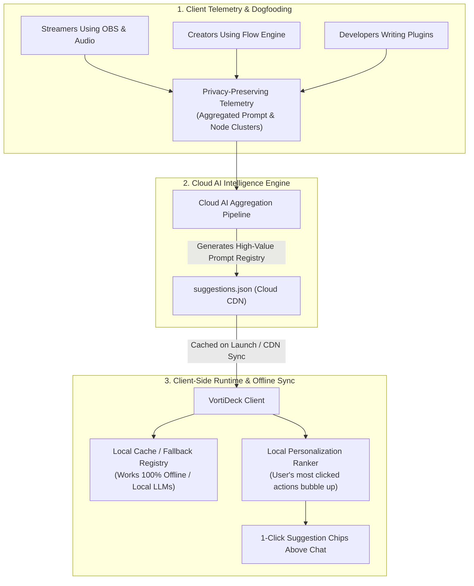

# Cloud-AI Dynamic Suggestion Registry & Telemetry Intelligence Architecture 🌐🧠

> **Planning update, 5 September 2026:** The earlier approved label is historical context; the mandatory cloud-only suggestion rule is reopened for P02 scope review. Compare local/offline usefulness and optional remote updates. This proposal is not a prerequisite for A02 truthful flow diagnosis/editing. Use root TODO and the detailed backlog for current task status and acceptance evidence.

**Author:** VortiDeck Core & AI Architecture Team  
**Date:** August 2026  
**Status:** Proposal; mandatory cloud-only direction superseded by the [architecture guide](ARCHITECTURE_GUIDE.md)  
**Target Systems:** `Studio Copilot`, `Cloudflare CDN / Worker`, `Telemetry Analytics Engine`, `Local App Sync`

---

## 1. Overview & Vision

Studio Copilot may ship useful local suggestion defaults and offline behavior. The automated intelligence loop below is an optional enhancement, subject to a concrete usefulness and privacy decision; it is not a prerequisite for a dependable copilot:



---

## 2. Telemetry & Pattern Discovery Layer

1. **Privacy-Preserving Aggregations:**
   - No raw chat messages or sensitive tokens are collected.
   - The engine logs anonymized event hashes:
     - `action_type`: e.g. `obs_scene_switch`, `flow_fix_node`, `macro_type_chat`
     - `node_category`: e.g. `streaming_trigger`, `logic_branch`
     - `error_fingerprint`: e.g. `obs_scene_not_found`, `http_401`
2. **Cluster Analysis:**
   - The cloud AI identifies recurring friction points (e.g. *"85% of users with Spotify nodes ask 'How do I display current song title in OBS?'"*).

---

## 3. Dynamic Suggestion Registry Schema (`suggestions.json`)

Hosted on Cloudflare CDN / Workers (`https://api.vortideck.com/v1/copilot/suggestions.json`):

```json
{
  "version": "2026.08.26",
  "updated_at": "2026-08-26T00:00:00Z",
  "defaults": [
    { "icon": "🎬", "label": "Switch OBS Scene", "prompt": "Switch my OBS scene to Gaming." },
    { "icon": "⚡", "label": "Run BRB Macro", "prompt": "List available macros and execute BRB mode." },
    { "icon": "🩺", "label": "Debug Last Flow", "prompt": "Why did my last stream workflow fail? Inspect execution history and logs." },
    { "icon": "📋", "label": "List Active Flows", "prompt": "List all my active automation flows." }
  ],
  "categories": {
    "obs": [
      { "icon": "🎬", "label": "Switch to Gaming Scene", "prompt": "Configure OBS scene switch to Gaming with Smooth Cut transition." },
      { "icon": "🎙️", "label": "Mute Desktop Audio", "prompt": "Mute Desktop Audio in OBS." },
      { "icon": "🩺", "label": "Test OBS Connection", "prompt": "Test OBS WebSocket connection and list active scenes." }
    ],
    "webhook": [
      { "icon": "🧪", "label": "Simulate Test Event", "prompt": "Simulate a test event with sample viewer payload." },
      { "icon": "📡", "label": "Pipe to Discord Alert", "prompt": "Add a Discord webhook step to announce this event." }
    ],
    "logic": [
      { "icon": "🔀", "label": "Branch by Amount > $10", "prompt": "If amount is greater than 10 route to VIP Alert, else Standard Alert." }
    ],
    "audio": [
      { "icon": "🔊", "label": "Set Volume 80%", "prompt": "Set playback volume to 80% with smooth fade-in." },
      { "icon": "🗣️", "label": "Convert to TTS Alert", "prompt": "Convert alert to speak viewer message via text-to-speech." }
    ],
    "rotary": [
      { "icon": "🎛️", "label": "Bind to Master Volume", "prompt": "Bind rotary knob to Windows master system volume." },
      { "icon": "🎧", "label": "Bind to Discord Voice", "prompt": "Bind rotary knob to Discord voice volume." }
    ]
  }
}
```

---

## 4. Client-Side Resolution & Offline First

1. **Startup Check:**
   - Background worker checks CDN `ETag` on app launch (< 20ms).
   - If changed, updates SQLite local cache `copilot_suggestions_cache`.
2. **Offline & Local LLM Guarantee:**
   - When offline or when using local models (Ollama, LM Studio), Copilot uses the cached registry without network roundtrips.
3. **Local Personalization Ranker:**
   - Every time a user clicks a suggestion chip, the local score for that prompt increases (`clickCount++`).
   - The top 4 highest-scoring chips for that context type bubble to the front!

---

## 5. Implementation Milestones

- [ ] **Phase 1 (Current):** Lightweight client-side suggestion helper with standard fallbacks.
- [ ] **Phase 2:** Host `suggestions.json` on Cloudflare CDN and wire cache-first fetcher.
- [ ] **Phase 3:** Telemetry cluster analyzer & automated prompt generation in Cloud AI pipeline.
