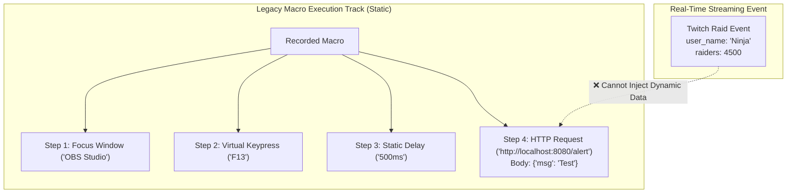
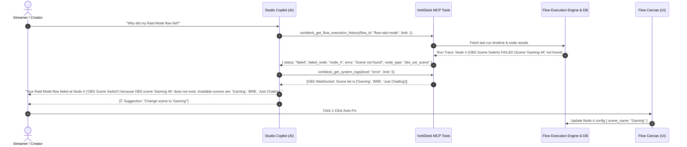

# Dynamic Macro Parameter Passing & Live Flow Debugging Architecture ⚡🎛️

**Author:** VortiDeck Core & AI Team  
**Date:** August 2026  
**Status:** Approved Architectural Blueprint  
**Target Systems:** `vortideck-core` (Rust), `Studio Copilot` (MCP 2.0), `Flow Engine` (`layers/flow/`), `Macro Engine` (`layers/desktop/`)

---

## Executive Summary

This document details the architectural evolution of automation in VortiDeck, contrasting legacy static macros with dynamic flow execution, and establishes the blueprint for **Live Flow Debugging** via Studio Copilot MCP Tools (`vortideck_get_flow_execution_history`, `vortideck_get_system_logs`, and 1-Click Auto-Fix Suggestions).

---

## 1. Historical Analysis: The Legacy Macro vs. Streaming Dilemma

### 1.1 The Root Cause of Macro Rigidity

In earlier versions of VortiDeck, the **Macro System** was built as a linear, recorded playback sequence:



### 1.2 Why Dynamic Injection Failed in Static Macros
1. **Deterministic Action Serializers:** Macro steps were serialized directly to the database as fixed structs (`KeyAction { key: "F13" }`, `HttpAction { url: "...", body: "..." }`).
2. **Missing Runtime Variable Scope:** No runtime context or environment symbol table was passed down during `execute_macro(macro_id)`.
3. **No Branching or Conditional Logic:** If a streamer wanted to type a custom username or handle sub tiers differently (Tier 1 vs Tier 3), a static macro could not evaluate conditions.

---

## 2. The Solution: Visual Flow Engine & Dynamic Execution

### 2.1 The Two Pillars of Dynamic Automation Today

```mermaid
flowchart LR
    subgraph "Pillar 1: Dynamic Flow Execution"
        A["Copilot / Stream Event"] -->|Payload: { user: 'Alex', amount: 25 }| B["Flow Trigger Node"]
        B --> C["Data Pipe Wires"]
        C --> D["Action Nodes (TTS, Overlay HUD, OBS)"]
    end

    subgraph "Pillar 2: Direct Macro Parameter Substitution"
        E["Copilot MCP Tool"] -->|Args: { text: 'Welcome!' }| F["Macro Engine"]
        F -->|Substitute {{text}}| G["OS Keyboard Driver"]
    end
```

### 2.2 Direct Macro Parameter Passing (`vortideck_run_macro`)
For lightweight sequential macros that need runtime flexibility without building a full flow:
- Macro text steps support template tokens: `{{text}}`, `{{username}}`, `{{amount}}`.
- The MCP tool `vortideck_run_macro` accepts an optional `arguments: Record<string, any>` dictionary.
- The execution engine performs string interpolation prior to invoking native OS keyboard/mouse input drivers.

### 2.3 Visual Flow Parameter Injection (`vortideck_run_flow`)
For complex automations involving parallel branching, async timers, API calls, and OBS transitions:
- Workflows are triggered with a full JSON context payload (`$event.payload`).
- Nodes reference data dynamically using dot-notation (`$event.payload.user_name`, `$node.2.outputs.status`).

---

## 3. Live Flow Debugging & Diagnostics Architecture 🔍🩺

When an automated workflow fails during a live broadcast, streamers need instant root-cause analysis without digging through raw logs.



---

## 4. MCP Tools Specification

### 4.1 `vortideck_get_flow_execution_history`
```json
{
  "name": "vortideck_get_flow_execution_history",
  "description": "Queries the execution history, timeline steps, node status, and input/output payloads of recent workflow runs for debugging.",
  "parameters": {
    "type": "object",
    "properties": {
      "flow_id": {
        "type": "string",
        "description": "Optional workflow ID to filter execution history"
      },
      "status": {
        "type": "string",
        "enum": ["all", "failed", "completed", "running"],
        "description": "Filter by execution status (default: 'all')"
      },
      "limit": {
        "type": "number",
        "description": "Max number of execution traces to return (default: 5)"
      }
    }
  }
}
```

### 4.2 `vortideck_get_system_logs`
```json
{
  "name": "vortideck_get_system_logs",
  "description": "Queries the recent application logs, warnings, and errors from the VortiDeck logging system for diagnostics.",
  "parameters": {
    "type": "object",
    "properties": {
      "level": {
        "type": "string",
        "enum": ["all", "error", "warn", "info", "debug"],
        "description": "Minimum log level (default: 'warn')"
      },
      "source": {
        "type": "string",
        "description": "Optional component filter (e.g. 'obs', 'mcp', 'flow', 'webhook')"
      },
      "limit": {
        "type": "number",
        "description": "Max log entries to return (default: 20)"
      }
    }
  }
}
```

---

## 5. 1-Click Auto-Fix Suggestion Protocol

When the Copilot returns suggestions in its chat response:
```json
{
  "suggestions": [
    {
      "label": "⚡ Fix Node: Set OBS Scene to 'Gaming'",
      "action": "flow_update_node",
      "value": {
        "flowId": "flow-raid-mode",
        "nodeId": "node_4",
        "patch": {
          "data": {
            "sceneName": "Gaming"
          }
        }
      }
    }
  ]
}
```
Clicking the suggestion button dispatches `assistant_fill_value` / `emitTo('main', 'flow_apply_patch', ...)` which automatically highlights the target node on the canvas and applies the validated fix!
