# VoiceFlow Telephony Plugin for VortiDeck

> A service plugin that brings Asterisk PBX telephony management, speech-to-text transcription, and voice-activated dialing to VortiDeck flows.

## Overview

The VoiceFlow plugin transforms the [ari-stasi-server](https://github.com/your-repo/ari-stasi-server) telephony system into a collection of VortiDeck flow nodes. This enables visual programming of complex telephony workflows including IVR systems, call routing, voice-activated dialing, and real-time transcription.

---

## System Architecture

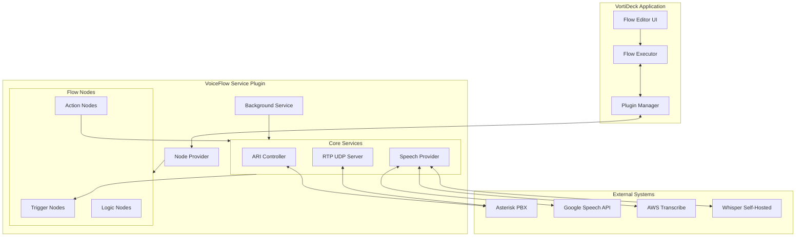

---

## Plugin Manifest

```json
{
  "id": "voiceflow:telephony",
  "name": "VoiceFlow Telephony",
  "version": "1.0.0",
  "author": "VortiDeck Team",
  "description": "Asterisk PBX telephony management with speech recognition",
  "vortideck_version": ">=0.1.0",
  "schema_version": "1.0",
  "plugin_type": "service",
  "permissions": [
    "network",
    "storage",
    "background_service"
  ],
  "service": {
    "entry": "service/index.js",
    "auto_start": true
  },
  "configuration": {
    "pbx_ip": { "type": "string", "required": true },
    "pbx_username": { "type": "string", "required": true },
    "pbx_password": { "type": "string", "required": true, "secret": true },
    "speech_provider": { "type": "enum", "values": ["google", "aws", "whisper"], "default": "google" },
    "speech_language": { "type": "string", "default": "en-US" },
    "rtp_port": { "type": "number", "default": 8000 }
  }
}
```

---

## Node Categories

### Trigger Nodes

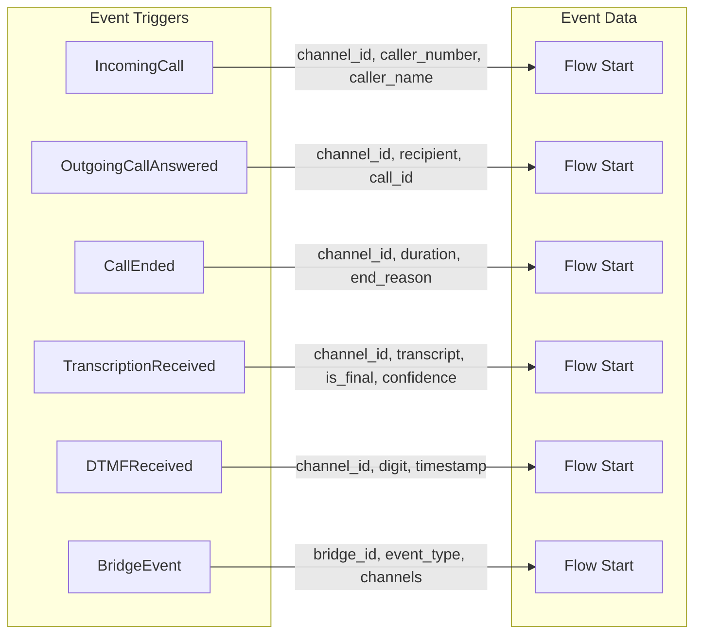

### Action Nodes

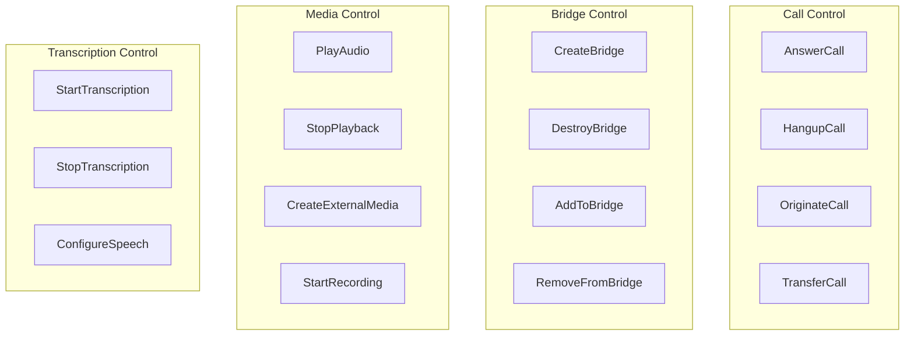

### Logic Nodes

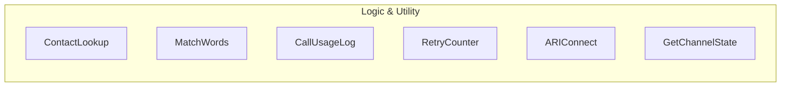

---

## Complete Node Reference

### Trigger Nodes

#### IncomingCall
Fires when a new call enters the Stasis application.

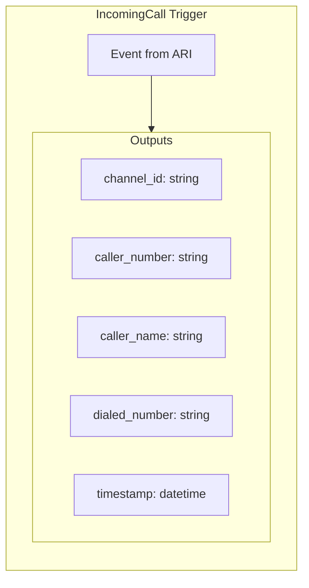

#### TranscriptionReceived
Fires when speech-to-text produces a result.

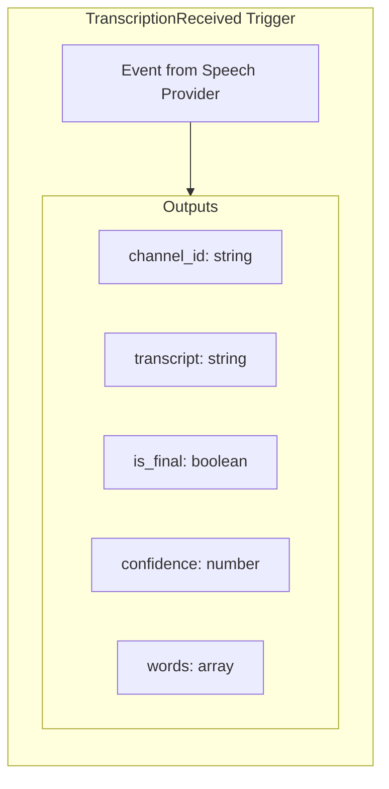

---

### Action Nodes

#### OriginateCall
Initiates an outbound call.

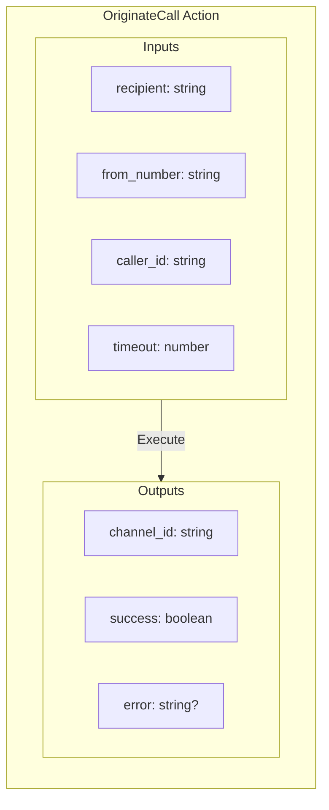

#### PlayAudio
Plays audio to a channel.

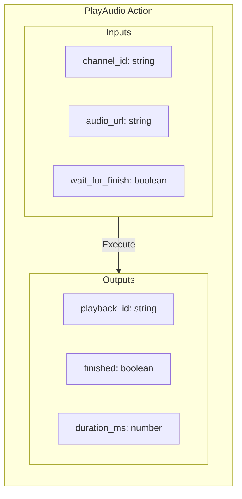

#### CreateExternalMedia
Creates an external media channel for RTP streaming (used for transcription).

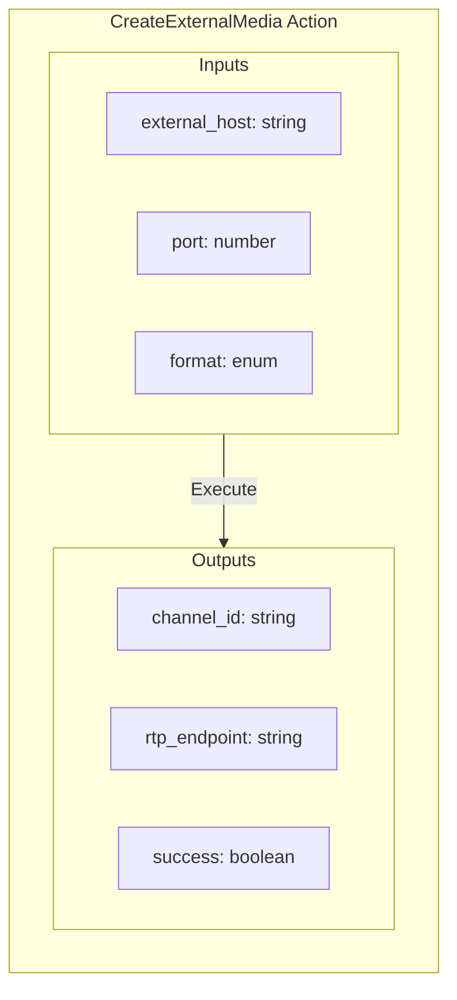

---

### Logic Nodes

#### ContactLookup
Searches contacts database by spoken words.

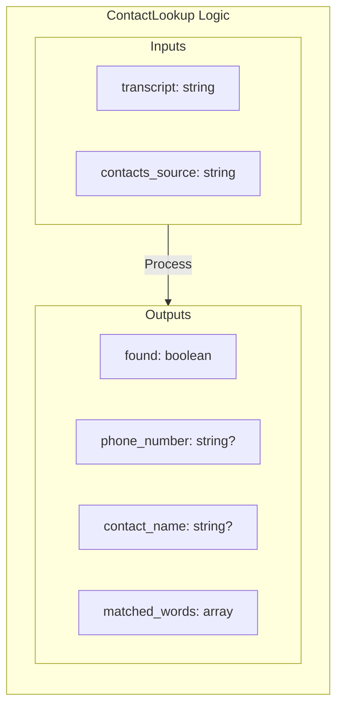

#### RetryCounter
Tracks retry attempts with configurable limits.

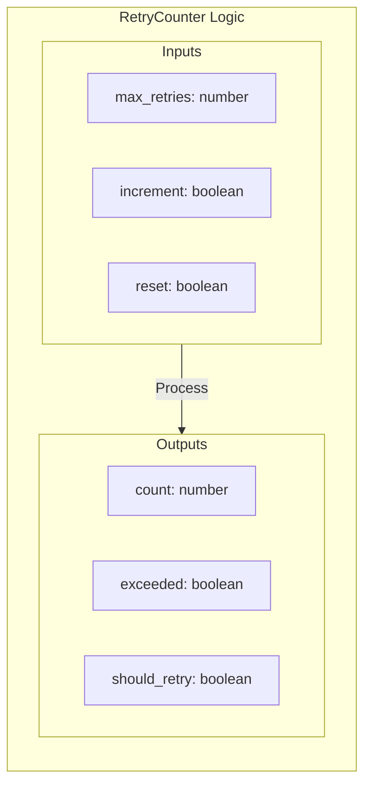

---

## Example Flows

### Flow 1: Voice-Activated Dialing (IVR)

This recreates the main functionality of ari-stasi-server.

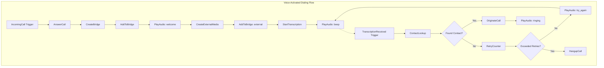

### Flow 2: Call Recording with Transcription

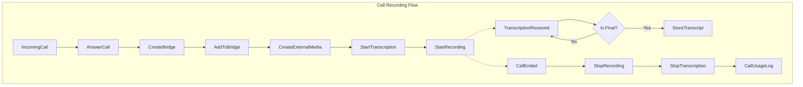

### Flow 3: DTMF Menu Navigation

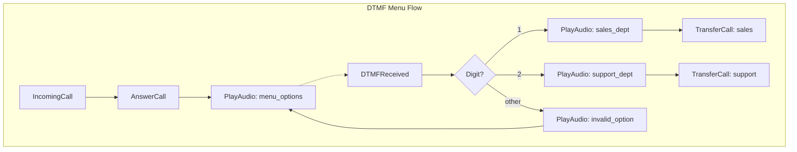

---

## Data Flow Architecture

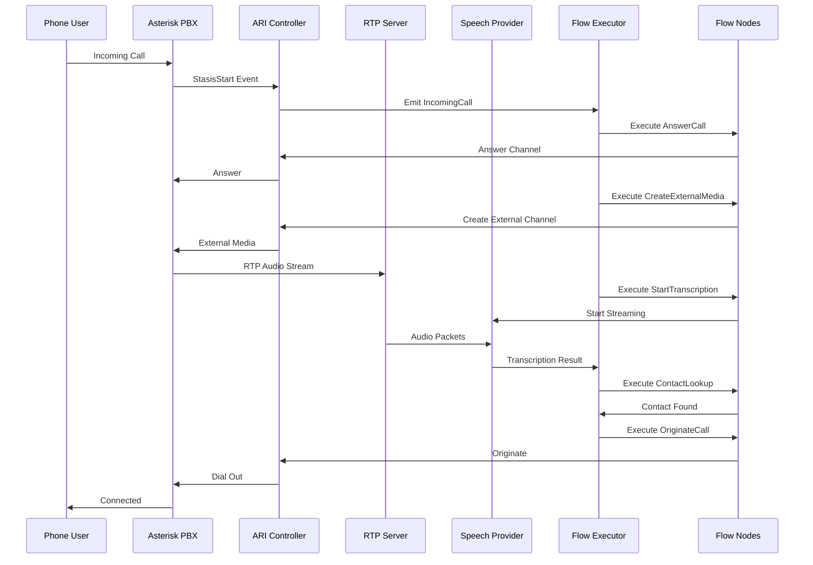

---

## Service Lifecycle

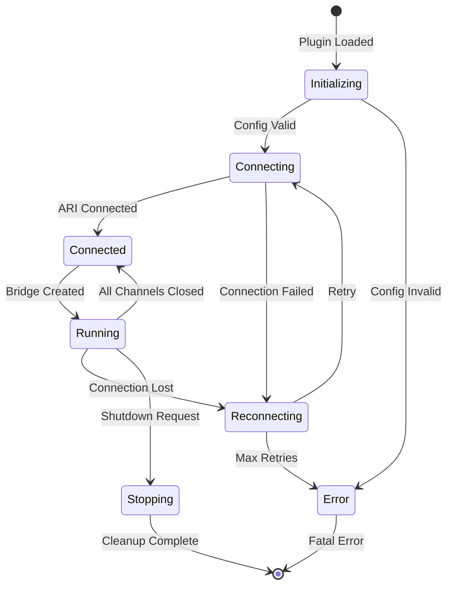

---

## Configuration

### Environment Variables

| Variable | Description | Default |
|----------|-------------|---------|
| `PBX_IP` | Asterisk PBX IP address | required |
| `ASTERISK_LOGIN` | ARI username | required |
| `ASTERISK_PASSWORD` | ARI password | required |
| `WSS_PORT` | WebSocket server port | 3044 |
| `LISTENER_SERVER` | RTP listener address | 0.0.0.0:8000 |
| `EXTERNAL_HOST` | External host for RTP | required |
| `SPEECH_LANG` | Speech recognition language | en-US |
| `SPEECH_MODEL` | Speech recognition model | default |
| `FROM_NUMBER` | Default caller ID | required |
| `SIP_PROVIDER` | SIP provider trunk | required |

### Contacts Database

```json
{
  "contacts": [
    {
      "name": "John Doe",
      "phone": "+1234567890",
      "words": ["john", "doe", "sales"]
    },
    {
      "name": "Support Team",
      "phone": "+1234567891",
      "words": ["support", "help", "technical"]
    }
  ]
}
```

---

## Speech Provider Comparison

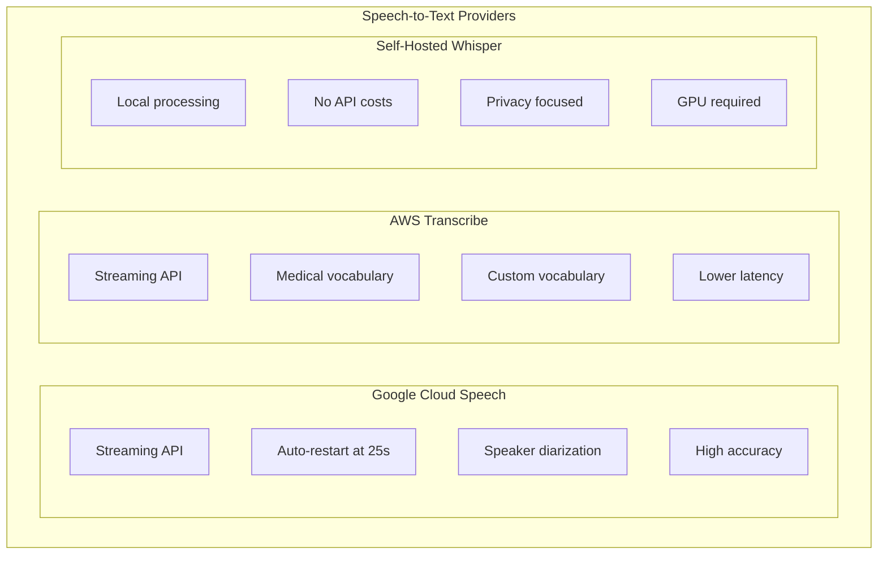

---

## Error Handling

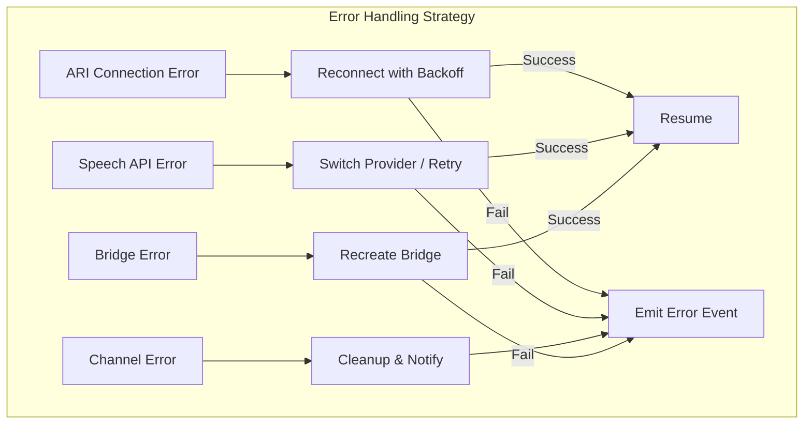

---

## Implementation Roadmap

### Phase 1: Core Infrastructure
- [ ] Service plugin scaffold
- [ ] ARI connection management
- [ ] Basic call control nodes (Answer, Hangup, Originate)
- [ ] Bridge management nodes

### Phase 2: Audio & Transcription
- [ ] RTP UDP server integration
- [ ] External media channel support
- [ ] Google Speech provider
- [ ] Transcription trigger node

### Phase 3: Advanced Features
- [ ] Contact lookup logic node
- [ ] DTMF handling
- [ ] Call recording
- [ ] Multiple speech providers (AWS, Whisper)

### Phase 4: Polish & Optimization
- [ ] Error recovery and reconnection
- [ ] Call analytics and logging
- [ ] Web UI for configuration
- [ ] Performance optimization

---

## Related Documentation

- [Plugin Architecture](./plugin-architecture.md)
- Service Plugin Development
- Flow Node API
- [Asterisk ARI Documentation](https://wiki.asterisk.org/wiki/display/AST/Asterisk+REST+Interface)
- [Google Cloud Speech-to-Text](https://cloud.google.com/speech-to-text/docs)
