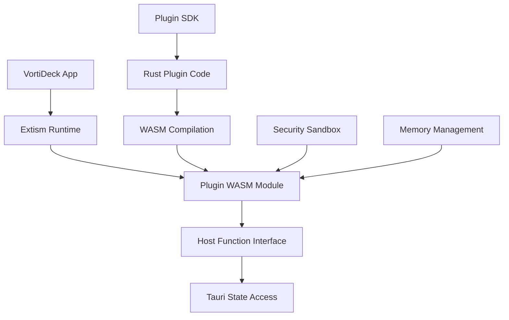

# 🔌 VortiDeck Plugin SDK Architecture

## 🎯 Overview & Goals

### Core Requirements
- **Deep Integration**: Plugins can access shared Tauri state
- **Function Exposure**: Plugins can call and extend app functions
- **Service Integration**: Add new servers, MCP connections, etc.
- **Security**: Sandboxed execution with controlled access
- **Performance**: Near-native performance for compute-heavy plugins
- **Developer Experience**: Easy SDK with great tooling

### Example Use Case: OpenAI Whisper Plugin
```rust
// Plugin adds local speech-to-text capability
VortiDeck Plugin: "whisper-voice-control"
├── Whisper model runner (local inference)
├── Voice command parser
├── Integration with existing command pool
├── New flow nodes (speech-to-text, voice trigger)
└── Voice control settings UI
```

## 🏗️ Architecture Options Analysis

### 1. 🌐 WebAssembly + Extism (Recommended)

#### Why Extism + WASM?


#### Core Architecture
```rust
// Host-side plugin manager
pub struct PluginManager {
    extism_runtime: extism::Runtime,
    plugins: HashMap<String, PluginInstance>,
    shared_state: Arc<VortiDeckSharedState>,
    function_registry: Arc<HostFunctionRegistry>,
}

#[derive(Clone)]
pub struct VortiDeckSharedState {
    // Shared resources plugins can access
    pub flow_registry: Arc<FlowRegistryState>,
    pub chat_state: Arc<ChatState>,
    pub app_config: Arc<Mutex<AppConfig>>,
    pub command_pool: Arc<Mutex<CommandPool>>,
    pub server_registry: Arc<Mutex<ServerRegistry>>,
}

pub struct PluginInstance {
    id: String,
    plugin: extism::Plugin,
    capabilities: PluginCapabilities,
    permissions: PluginPermissions,
}
```

#### Host Function Interface
```rust
// Functions exposed to plugins
pub struct HostFunctionRegistry {
    functions: HashMap<String, Box<dyn HostFunction>>,
}

#[async_trait]
pub trait HostFunction: Send + Sync {
    async fn call(
        &self,
        plugin_id: &str,
        args: Vec<u8>,
        state: &VortiDeckSharedState,
    ) -> Result<Vec<u8>, PluginError>;
    
    fn requires_permission(&self) -> Permission;
}

// Example host functions
pub struct FlowRegistryFunction;
pub struct ChatStateFunction;
pub struct AddCommandFunction;
pub struct RegisterServerFunction;
pub struct CreateFlowNodeFunction;
```

#### Plugin-Side SDK
```rust
// Plugin SDK (compiled to WASM)
pub struct VortiDeckPlugin {
    id: String,
    manifest: PluginManifest,
}

impl VortiDeckPlugin {
    // Access shared state
    pub async fn get_flow_registry(&self) -> Result<FlowRegistryProxy, Error> {
        let response = call_host_function("flow_registry.get", &[])?;
        Ok(FlowRegistryProxy::from_bytes(response))
    }
    
    // Add new command
    pub async fn register_voice_command(
        &self,
        command: VoiceCommand,
    ) -> Result<(), Error> {
        let data = serialize(&command)?;
        call_host_function("commands.register", &data)?;
        Ok(())
    }
    
    // Create new flow nodes
    pub async fn register_flow_node(
        &self,
        node: FlowNodeDefinition,
    ) -> Result<(), Error> {
        let data = serialize(&node)?;
        call_host_function("flow_registry.register_node", &data)?;
        Ok(())
    }
    
    // Add new server
    pub async fn register_server(
        &self,
        server_config: ServerConfig,
    ) -> Result<(), Error> {
        let data = serialize(&server_config)?;
        call_host_function("servers.register", &data)?;
        Ok(())
    }
}

// Host function calling interface
extern "C" {
    fn call_host_function(
        name: *const u8,
        name_len: usize,
        data: *const u8,
        data_len: usize,
    ) -> i32;
}
```

### 2. 🔧 Plugin Manifest & Capabilities

#### Plugin Manifest
```toml
# plugin.toml
[package]
name = "whisper-voice-control"
version = "1.0.0"
description = "Local speech-to-text with voice commands"
author = "Your Name"
license = "MIT"

[capabilities]
# What the plugin can access
shared_state = ["flow_registry", "chat_state", "command_pool"]
host_functions = [
    "flow_registry.register_node",
    "commands.register",
    "servers.register",
    "file_system.read",
    "audio.capture"
]
system_resources = ["microphone", "gpu"]

[runtime]
# WASM configuration
memory_limit = "512MB"
cpu_timeout = "30s"
network_access = false
file_system_access = "restricted"

[ui_extensions]
# UI components the plugin adds
settings_panel = "whisper_settings"
flow_nodes = ["speech_to_text", "voice_trigger"]
toolbar_buttons = ["voice_toggle"]

[dependencies]
# Other plugins this depends on
requires = []
conflicts = ["other-voice-plugin"]
```

#### Permission System
```rust
#[derive(Debug, Clone, Serialize, Deserialize)]
pub enum Permission {
    // State access permissions
    ReadFlowRegistry,
    WriteFlowRegistry,
    ReadChatState,
    WriteChatState,
    
    // System permissions
    AudioCapture,
    FileSystemRead(PathBuf),
    FileSystemWrite(PathBuf),
    NetworkAccess,
    GpuAccess,
    
    // App integration permissions
    RegisterFlowNodes,
    RegisterCommands,
    RegisterServers,
    ModifyUI,
    AccessUserData,
}

pub struct PluginPermissions {
    granted: HashSet<Permission>,
    user_approved: bool,
    auto_approved: HashSet<Permission>, // Safe permissions
}
```

### 3. 🎤 Whisper Plugin Example Implementation

#### Plugin Code Structure
```rust
// plugins/whisper-voice-control/src/lib.rs
use vortideck_plugin_sdk::*;

pub struct WhisperPlugin {
    whisper_model: WhisperModel,
    voice_commands: VoiceCommandRegistry,
    audio_buffer: AudioBuffer,
}

#[plugin_main]
impl WhisperPlugin {
    pub async fn initialize(context: PluginContext) -> Result<Self, Error> {
        // Load Whisper model
        let model_path = context.plugin_dir().join("models/whisper-base.bin");
        let whisper_model = WhisperModel::load(model_path)?;
        
        // Initialize voice command registry
        let voice_commands = VoiceCommandRegistry::new();
        
        // Setup audio capture
        let audio_buffer = AudioBuffer::new(16000)?; // 16kHz sample rate
        
        Ok(Self {
            whisper_model,
            voice_commands,
            audio_buffer,
        })
    }
    
    // Plugin lifecycle hooks
    pub async fn on_activate(&mut self, sdk: &VortiDeckSDK) -> Result<(), Error> {
        // Register flow nodes
        self.register_flow_nodes(sdk).await?;
        
        // Register voice commands
        self.register_voice_commands(sdk).await?;
        
        // Start audio capture
        self.start_audio_capture(sdk).await?;
        
        Ok(())
    }
    
    async fn register_flow_nodes(&self, sdk: &VortiDeckSDK) -> Result<(), Error> {
        // Speech-to-text node
        let stt_node = FlowNodeDefinition {
            id: "whisper.speech_to_text".to_string(),
            name: "Speech to Text".to_string(),
            description: "Convert audio to text using Whisper".to_string(),
            category: "Audio".to_string(),
            inputs: vec![
                InputDefinition {
                    name: "audio_file".to_string(),
                    input_type: "file".to_string(),
                    required: true,
                }
            ],
            outputs: vec![
                OutputDefinition {
                    name: "text".to_string(),
                    output_type: "string".to_string(),
                }
            ],
            handler: "handle_speech_to_text".to_string(),
        };
        
        sdk.register_flow_node(stt_node).await?;
        
        // Voice trigger node
        let trigger_node = FlowNodeDefinition {
            id: "whisper.voice_trigger".to_string(),
            name: "Voice Trigger".to_string(),
            description: "Trigger flow on voice command".to_string(),
            category: "Triggers".to_string(),
            inputs: vec![
                InputDefinition {
                    name: "trigger_phrase".to_string(),
                    input_type: "string".to_string(),
                    required: true,
                }
            ],
            outputs: vec![
                OutputDefinition {
                    name: "triggered".to_string(),
                    output_type: "boolean".to_string(),
                }
            ],
            handler: "handle_voice_trigger".to_string(),
        };
        
        sdk.register_flow_node(trigger_node).await?;
        
        Ok(())
    }
    
    async fn register_voice_commands(&self, sdk: &VortiDeckSDK) -> Result<(), Error> {
        let commands = vec![
            VoiceCommand {
                phrase: "start recording".to_string(),
                action: CommandAction::StartFlow("recording_flow".to_string()),
                confidence_threshold: 0.8,
            },
            VoiceCommand {
                phrase: "stop recording".to_string(),
                action: CommandAction::StopFlow("recording_flow".to_string()),
                confidence_threshold: 0.8,
            },
            VoiceCommand {
                phrase: "volume up".to_string(),
                action: CommandAction::SystemCommand("volume_up".to_string()),
                confidence_threshold: 0.9,
            },
        ];
        
        for command in commands {
            sdk.register_voice_command(command).await?;
        }
        
        Ok(())
    }
    
    // Flow node handlers
    #[flow_node_handler]
    pub async fn handle_speech_to_text(
        &self,
        inputs: FlowNodeInputs,
        sdk: &VortiDeckSDK,
    ) -> Result<FlowNodeOutputs, Error> {
        let audio_file = inputs.get_file("audio_file")?;
        let audio_data = sdk.read_file(audio_file).await?;
        
        // Process with Whisper
        let text = self.whisper_model.transcribe(&audio_data)?;
        
        let mut outputs = FlowNodeOutputs::new();
        outputs.set("text", text);
        Ok(outputs)
    }
    
    #[flow_node_handler]
    pub async fn handle_voice_trigger(
        &self,
        inputs: FlowNodeInputs,
        sdk: &VortiDeckSDK,
    ) -> Result<FlowNodeOutputs, Error> {
        let trigger_phrase = inputs.get_string("trigger_phrase")?;
        
        // Start listening for the phrase
        let triggered = self.listen_for_phrase(&trigger_phrase).await?;
        
        let mut outputs = FlowNodeOutputs::new();
        outputs.set("triggered", triggered);
        Ok(outputs)
    }
}
```

### 4. 🛠️ SDK Developer Experience

#### Plugin Development Workflow
```bash
# 1. Create new plugin project
vortideck plugin new whisper-voice-control --template audio

# 2. Generated project structure
whisper-voice-control/
├── Cargo.toml
├── plugin.toml          # Plugin manifest
├── src/
│   ├── lib.rs           # Main plugin code
│   └── nodes/           # Flow node implementations
├── assets/
│   ├── models/          # Whisper model files
│   └── icons/           # UI icons
├── ui/                  # Optional UI components
│   ├── settings.vue     # Settings panel
│   └── components/      # Custom components
└── tests/               # Plugin tests

# 3. Build plugin
vortideck plugin build

# 4. Test plugin
vortideck plugin test

# 5. Package for distribution
vortideck plugin package

# 6. Install plugin
vortideck plugin install whisper-voice-control.vpkg
```

#### SDK Crate Structure
```rust
// vortideck-plugin-sdk/src/lib.rs
pub mod context;
pub mod flow_nodes;
pub mod voice_commands;
pub mod ui;
pub mod file_system;
pub mod audio;
pub mod networking;

// Re-exports for ease of use
pub use context::*;
pub use flow_nodes::*;
pub use voice_commands::*;

// Macros for plugin development
pub use vortideck_plugin_macros::*;

// Plugin main macro
#[macro_export]
macro_rules! plugin_main {
    ($plugin_type:ty) => {
        #[no_mangle]
        pub extern "C" fn plugin_initialize() -> i32 {
            // Initialize plugin
            0
        }
        
        #[no_mangle]
        pub extern "C" fn plugin_activate() -> i32 {
            // Activate plugin
            0
        }
        
        // Other required exports...
    };
}
```

### 5. 🔐 Security & Sandboxing

#### WASM Security Benefits
```rust
// Plugins run in sandboxed WASM environment
pub struct WasmSandbox {
    // Memory isolation
    memory_limit: usize,
    
    // CPU limits
    instruction_limit: u64,
    execution_timeout: Duration,
    
    // System access controls
    file_system_access: FileSystemPolicy,
    network_access: NetworkPolicy,
    system_calls: SystemCallPolicy,
}

pub enum FileSystemPolicy {
    None,                           // No file access
    ReadOnly(Vec<PathBuf>),        // Read-only access to specific paths
    Restricted(Vec<PathBuf>),      // Read/write to specific paths
}

// Host function verification
impl HostFunctionRegistry {
    pub fn call_function(
        &self,
        plugin_id: &str,
        function_name: &str,
        args: &[u8],
        permissions: &PluginPermissions,
    ) -> Result<Vec<u8>, Error> {
        // 1. Verify function exists
        let function = self.functions.get(function_name)
            .ok_or(Error::FunctionNotFound)?;
        
        // 2. Check permissions
        let required_permission = function.requires_permission();
        if !permissions.has_permission(required_permission) {
            return Err(Error::InsufficientPermissions);
        }
        
        // 3. Rate limiting
        self.check_rate_limit(plugin_id, function_name)?;
        
        // 4. Execute with state access
        function.call(plugin_id, args, &self.shared_state)
    }
}
```

### 6. 🎨 UI Extension System

#### Plugin UI Integration
```vue
<!-- Plugin-provided settings component -->
<!-- plugins/whisper-voice-control/ui/settings.vue -->
<template>
  <div class="whisper-settings">
    <h3>🎤 Whisper Voice Control</h3>
    
    <div class="setting-group">
      <label>Whisper Model</label>
      <select v-model="settings.model">
        <option value="tiny">Tiny (fastest)</option>
        <option value="base">Base (recommended)</option>
        <option value="large">Large (most accurate)</option>
      </select>
    </div>
    
    <div class="setting-group">
      <label>Confidence Threshold</label>
      <input 
        type="range" 
        v-model="settings.confidence" 
        min="0" 
        max="1" 
        step="0.1"
      />
      <span>{{ settings.confidence }}</span>
    </div>
    
    <div class="voice-commands">
      <h4>Voice Commands</h4>
      <div v-for="cmd in voiceCommands" :key="cmd.phrase">
        <input v-model="cmd.phrase" placeholder="Voice phrase" />
        <select v-model="cmd.action">
          <option value="start_flow">Start Flow</option>
          <option value="stop_flow">Stop Flow</option>
          <option value="system_command">System Command</option>
        </select>
        <button @click="removeCommand(cmd)">Remove</button>
      </div>
      <button @click="addCommand">Add Command</button>
    </div>
    
    <div class="actions">
      <button @click="testMicrophone">Test Microphone</button>
      <button @click="calibrateVoice">Calibrate Voice</button>
    </div>
  </div>
</template>

<script setup>
import { ref, onMounted } from 'vue'
import { usePluginAPI } from '@vortideck/plugin-api'

const plugin = usePluginAPI('whisper-voice-control')
const settings = ref({})
const voiceCommands = ref([])

onMounted(async () => {
  settings.value = await plugin.getSettings()
  voiceCommands.value = await plugin.getVoiceCommands()
})

const testMicrophone = async () => {
  await plugin.call('test_microphone')
}

const calibrateVoice = async () => {
  await plugin.call('calibrate_voice')
}
</script>
```

#### Plugin Node Components
```vue
<!-- Flow node UI for speech-to-text -->
<!-- plugins/whisper-voice-control/ui/nodes/SpeechToTextNode.vue -->
<template>
  <div class="speech-to-text-node">
    <div class="node-header">
      <Icon name="microphone" />
      <span>Speech to Text</span>
    </div>
    
    <div class="node-inputs">
      <input-port 
        name="audio_file" 
        type="file" 
        label="Audio File"
        accept=".wav,.mp3,.m4a"
      />
    </div>
    
    <div class="node-content">
      <div class="model-info">
        <span>Model: {{ modelName }}</span>
        <span>Language: {{ language }}</span>
      </div>
      
      <div class="controls" v-if="isConfiguring">
        <select v-model="language">
          <option value="auto">Auto-detect</option>
          <option value="en">English</option>
          <option value="es">Spanish</option>
          <option value="fr">French</option>
        </select>
        
        <label>
          <input type="checkbox" v-model="enableTimestamps" />
          Include timestamps
        </label>
      </div>
    </div>
    
    <div class="node-outputs">
      <output-port 
        name="text" 
        type="string" 
        label="Transcribed Text"
      />
      <output-port 
        v-if="enableTimestamps"
        name="timestamps" 
        type="array" 
        label="Timestamps"
      />
    </div>
  </div>
</template>
```

### 7. 📦 Plugin Distribution & Marketplace

#### Plugin Package Format
```rust
// .vpkg file structure (ZIP-based)
whisper-voice-control.vpkg
├── manifest.json        # Plugin metadata
├── plugin.wasm         # Compiled WASM module
├── assets/
│   ├── models/         # Model files
│   └── icons/          # UI assets
├── ui/                 # UI components
│   ├── settings.js
│   └── nodes/
└── docs/               # Documentation
    ├── README.md
    └── api.md

// Package manifest
{
  "name": "whisper-voice-control",
  "version": "1.0.0",
  "description": "Local speech-to-text with voice commands",
  "author": "Your Name",
  "license": "MIT",
  "homepage": "https://github.com/user/whisper-plugin",
  "repository": "https://github.com/user/whisper-plugin",
  "keywords": ["audio", "speech", "voice", "whisper"],
  "vortideck_version": ">=1.0.0",
  "size": 45000000,  // 45MB
  "checksum": "sha256:abc123...",
  "permissions": [
    "audio_capture",
    "file_system_read",
    "flow_registry_write"
  ],
  "dependencies": [],
  "conflicts": ["other-voice-plugin"]
}
```

#### Plugin Marketplace
```rust
// Plugin registry service
pub struct PluginMarketplace {
    plugins: HashMap<String, PluginMetadata>,
    downloads: PluginDownloadService,
    reviews: PluginReviewService,
    security_scanner: SecurityScanner,
}

impl PluginMarketplace {
    pub async fn search_plugins(
        &self,
        query: &str,
        category: Option<PluginCategory>,
    ) -> Vec<PluginMetadata> {
        // Search through available plugins
    }
    
    pub async fn install_plugin(
        &self,
        plugin_name: &str,
        version: Option<&str>,
    ) -> Result<PluginInstance, Error> {
        // Download, verify, and install plugin
    }
    
    pub async fn verify_plugin_security(
        &self,
        plugin_package: &[u8],
    ) -> SecurityReport {
        // Scan for malicious code, excessive permissions, etc.
    }
}
```

### 8. 🚀 Implementation Roadmap

#### Phase 1: Core Infrastructure (4-6 weeks)
- [x] Extism runtime integration
- [x] Basic host function interface
- [x] Plugin manifest system
- [x] Permission framework
- [x] WASM compilation toolchain

#### Phase 2: SDK Development (6-8 weeks)
- [x] Plugin SDK crate
- [x] Code generation macros
- [x] Development tools (CLI)
- [x] Documentation and examples
- [x] Testing framework

#### Phase 3: UI Integration (4-6 weeks)
- [x] Plugin UI component system
- [x] Settings panel integration
- [x] Flow node UI components
- [x] Vue.js plugin API

#### Phase 4: Marketplace (8-10 weeks)
- [x] Plugin packaging system
- [x] Distribution platform
- [x] Security scanning
- [x] Review and rating system
- [x] Automated testing

### 9. 🎯 Success Metrics

#### Developer Adoption
- Time to create first plugin: < 30 minutes
- Plugin compilation time: < 10 seconds
- SDK documentation coverage: 100%
- Community plugin submissions: 50+ in first 6 months

#### Performance Benchmarks
- Plugin loading time: < 500ms
- WASM execution overhead: < 5%
- Memory usage per plugin: < 50MB average
- Host function call latency: < 1ms

## 🚀 Conclusion

The **Extism + WebAssembly** approach provides the perfect balance of:
- ✅ **Security**: Sandboxed execution with controlled host access
- ✅ **Performance**: Near-native speed for compute-heavy plugins
- ✅ **Developer Experience**: Rich SDK with great tooling
- ✅ **Integration**: Deep access to Tauri state and app functions
- ✅ **Distribution**: Safe marketplace with security scanning

This architecture enables plugins like the Whisper voice control example to deeply integrate with VortiDeck while maintaining security and performance! 🎤🚀 